# 1. Linux and container foundations

[Guide index](README.md) · [Next: build and boot](02-build-and-boot.md)

This chapter explains the operating-system features beneath the desktop. The
project's concrete flags and paths are used as examples so the concepts remain
connected to commands you can inspect.

## A container runs processes on a shared kernel

A Linux desktop needs programs, libraries, configuration, processes, memory and
communication channels. A container image packages the userspace portion. The
runtime starts those programs using Linux isolation and resource-management
features.

The container uses the host's Linux kernel. It does not boot a second Linux kernel
like a conventional virtual machine. Its Fedora libraries can differ from the
host's distribution because the runtime presents the image's filesystem to its
processes. See Docker's [container run model](https://docs.docker.com/engine/containers/run/).

### Image, writable layer and mounts

The image provides read-only filesystem layers. A created container normally adds
a writable layer. Files written there belong to that container instance; a new
container created from the same image starts with a new writable layer.

Mounts can place other storage over particular paths. The important project paths
are a mixture of image content, container writes, temporary storage and host binds:

| Kind | Example | Lifetime and purpose |
| --- | --- | --- |
| Image content | `/usr/bin/kwin_wayland` | Installed while building the image |
| Container writable content | `/etc/plasma/session.env` | Written before systemd starts; specific to this container |
| `tmpfs` | `/run`, `/tmp` | Temporary runtime files; recreated by the documented run setup |
| Host bind mount | `/run/host/wayland` | A host socket exposed to nested mode |
| Writable host file mount | `/e2e-output/typed.txt` in UI tests | A host file whose contents survive container removal |

Deleting a container removes its writable layer. It does not delete a host file
merely because that file was bind-mounted. Conversely, editing a writable bind
mount edits the host's data.

## Namespaces provide different views

A namespace changes what a process sees for one category of operating-system
objects. It is not an image layer or a resource limit.

| Namespace | What differs inside the container | Why it matters here |
| --- | --- | --- |
| PID | Process-number view | Systemd can be PID 1 inside the container |
| Mount | Visible mount tree | Image files, runtime `tmpfs` and host binds coexist |
| Network | Interfaces, routes and loopback | Container `127.0.0.1` differs from host `127.0.0.1` |
| User | Mapping of UID/GID values | Container root can map to a non-root host identity |
| IPC | Certain shared-memory and IPC objects | Relevant to graphical applications and shared memory |
| UTS | Hostname and related identity | Explains why an X11 cookie restricted to a hostname needs normalization |
| Cgroup | View of the cgroup hierarchy | Systemd sees a container-appropriate resource-management tree |

Some flags share or alter particular namespaces. They do not all describe the same
thing: `--userns=host` affects user mapping, while `--cgroupns=private` affects the
cgroup view.

```bash
# HOST: inspect namespace links for a running container's PID 1.
# The printed identifiers vary between containers and hosts.
docker exec plasma6-vnc ls -l /proc/1/ns

# HOST: confirm the command occupying PID 1 inside the container.
docker exec plasma6-vnc cat /proc/1/comm
```

The kernel documentation describes resource management separately from namespace
views in its [cgroup v2 guide](https://docs.kernel.org/admin-guide/cgroup-v2.html).

## PID 1, process replacement and signals

In this project the entrypoint shell initially occupies container PID 1. It prepares
configuration and eventually replaces itself with systemd using `exec`.

A normal child-process launch and a process replacement have different results:

```bash
# Teaching examples: do not run these as replacements for the project entrypoint.

# Launching without exec creates another process and leaves the shell in charge.
# /usr/sbin/init --system

# exec replaces the shell's program while keeping the same process ID.
# exec /usr/sbin/init --system
```

Systemd can then supervise its services, collect child exit states, and coordinate
shutdown. The image sets `STOPSIGNAL SIGRTMIN+3`, which asks systemd to halt the
container when the runtime stops it. The runtime's stop timeout still applies;
forcing a kill can interrupt that orderly shutdown.

```bash
# HOST: ask the runtime to stop the container using its configured stop signal.
docker stop plasma6-vnc
```

Do not add `--init` to these run commands. That option inserts another small init
process, while this image already deliberately runs systemd as PID 1.

## Cgroups and why a desktop needs enough tasks

A cgroup groups processes for accounting, limits and management. Systemd organizes
services in that hierarchy; the container runtime also applies limits around the
container.

A desktop contains many processes and threads. The `pids` controller counts tasks,
including threads, so a limit can be reached even when a process listing does not
show thousands of distinct programs. A symptom is a failure to create a thread or
fork a process, often reported as `Resource temporarily unavailable`.

The launcher and documented commands explicitly allow 8192 tasks:

```bash
# These are options for a full run command:
# --cgroupns=private  gives the container its own cgroup namespace view.
# --pids-limit=8192   sets a task limit large enough for this desktop setup.

# HOST: inspect the current cgroup's task limit and usage inside the container.
docker exec plasma6-vnc cat /sys/fs/cgroup/pids.max /sys/fs/cgroup/pids.current

# HOST: a rising max counter is evidence that the limit was hit.
docker exec plasma6-vnc cat /sys/fs/cgroup/pids.events
```

Cgroup access must also be suitable for systemd to manage its services. Rootless
Podman relies on the host's cgroup v2 setup and delegation. The project does not
configure the host's rootless-container prerequisites.

## Root, capabilities and privileged mode

Linux normally uses numeric UID 0 for root. Capabilities divide some privileged
operations into smaller permissions, such as changing ownership or managing
certain mounts. A runtime can also apply syscall filtering and security policies.

The documented project setup uses `--privileged` to provide the access needed by
its systemd-based environment. This is a significant runtime choice, not a normal
application permission. With a rootful Docker daemon it grants broad host-level
access. A rootless Podman process remains bounded by the calling user's host
privileges and its user namespace; the same flag does not make it host root.

This guide explains the current supported setup. It does not claim that the image
has been reduced to a least-privilege capability set. Run it in an environment
appropriate for a privileged desktop container. The engine documentation describes
[Docker privileges](https://docs.docker.com/engine/containers/run/#runtime-privilege-and-linux-capabilities)
and [Podman's run options](https://docs.podman.io/en/latest/markdown/podman-run.1.html).

### Systemd root and desktop user are separate roles

PID 1 starts as container root so it can prepare the account, ownership and service
environment. Project desktop services declare `User=plasma`; systemd runs those
programs as that account and its primary group.

Using `--user=plasma` for the whole container would also run the init framework as
that user. It would prevent the required preparation. The correct separation is:

```ini
# A service definition inside the image, not a docker run option.
[Service]
# systemd starts this specific service as the desktop account.
User=plasma
```

## Numeric IDs and user namespace mapping

Linux file permissions use numeric owner and group IDs. The host's username and
the container's username can differ while referring to the same mapped identity.



[Mermaid source](diagrams/identities.mmd). The subordinate UID shown is an example;
actual allocations depend on the host configuration.

### Rootful Docker: `--userns=host`

With a rootful Docker daemon, `--userns=host` disables user-namespace remapping for
that container. It does not rename accounts or change the desktop account's UID.
The project separately accepts runtime `PLASMA_UID` and `PLASMA_GID` settings.

```bash
# HOST: these numbers identify your current user and primary group.
id -u
id -g

# In a full Docker run command, supply both the mapping choice and desired account IDs:
# --userns=host --user=0:0
# -e PLASMA_UID="$(id -u)" -e PLASMA_GID="$(id -g)"
```

The account module runs before desktop processes exist. It validates the requested
IDs, rejects a UID owned by another account, reuses or adjusts a group, runs
`usermod`, and updates applicable home-directory ownership. It does not need a
host-specific image build. Its implementation is
[`300-plasma-user.sh`](../init.d/modules/300-plasma-user.sh).

Docker documents the distinction between remapping and a per-container `host`
override in its [user namespace guide](https://docs.docker.com/engine/security/userns-remap/).
These examples target a rootful Docker daemon; Docker rootless has different ID
mapping behavior.

### Rootless Podman: `--userns=keep-id`

The supported Podman path maps the caller's host identity into the container using
`keep-id`. Bare `keep-id` also changes the default initial process user, so this
image explicitly overrides it back to container root:

```bash
# Options for a full Podman run command:
# --userns=keep-id  maps the caller's numeric IDs to the same container IDs.
# --user=0:0       keeps the entrypoint and systemd running as container root.
# --passwd=false   stops Podman injecting another account at the requested UID.
# -e PLASMA_UID="$(id -u)" -e PLASMA_GID="$(id -g)"

# HOST: confirm that your Podman engine is rootless.
podman info --format '{{.Host.Security.Rootless}}'
```

The account module assigns the caller's IDs to `plasma`. That desktop process then
maps to the calling host user, while container root maps into subordinate IDs.
Disabling passwd injection matters when the image originally used a different
UID: otherwise Podman can insert a host-user entry at the UID init wants to assign
to `plasma`.

For an image whose desktop account is already known to be UID/GID 1000, an alternative
is `--userns=keep-id:uid=1000,gid=1000 --user=0:0 --passwd=false` with no runtime
account override. The namespace then maps the host caller to the image's existing
account IDs. The [Podman user namespace documentation](https://docs.podman.io/en/latest/markdown/podman-run.1.html#userns-mode)
defines these options.

```bash
# HOST command: inspect namespace maps inside a running Podman container.
podman exec plasma6-vnc cat /proc/1/uid_map /proc/1/gid_map
```

A map row contains an inside ID, an outside ID, and a range length. The outside IDs
are relative to the relevant parent namespace; rootless Podman can nest namespaces.
Do not automatically interpret every outside value as an ID in the initial host
namespace. Compare the maps with the runtime's process information and the observed
owner of a host-written file.

## Mounts: shared files, private sockets and temporary storage



[Mermaid source](diagrams/mounts.mmd). Not every mount is present in every mode.
The `X0` and `X100` numbers illustrate a common arrangement; the actual host number
is detected and the private display can become `:101` if the host uses `:100`.

### A bind mount is another path to host data

The runtime can expose a host path inside the container. `readonly` prevents
filesystem modifications through that mount. It does not turn a mounted Unix socket
into a receive-only communication channel: connecting and exchanging protocol
messages is the point of a display socket mount.

```bash
# Fragment of a full run command: expose one host Wayland socket read-only.
# --mount "type=bind,source=$XDG_RUNTIME_DIR/$WAYLAND_DISPLAY,target=/run/host/wayland,readonly"

# HOST: create a directory for data you want to survive container removal.
mkdir -p "$PWD/shared"

# Fragment: expose it as a writable folder inside the desktop user's home.
# --mount "type=bind,source=$PWD/shared,target=/home/plasma/Shared"
```

With `--mount type=bind`, the source must exist. Mounting over an existing container
path hides the underlying image content at that path for the duration of the mount.
See the [Docker bind-mount guide](https://docs.docker.com/engine/storage/bind-mounts/).

### File mode `0600`, directory mode `0700`, and the sticky bit

| Mode | Meaning in this project |
| --- | --- |
| `0600` | Only the owner can read/write a password, cookie, or test output file |
| `0700` | Only the owner can access a private runtime directory |
| `1777` | A shared writable directory with the sticky bit, used for `/tmp` and the local X11 socket directory |

The sticky bit restricts removing or renaming entries owned by other users in a
shared directory. It is not encryption and does not provide display authentication.
These modes describe ordinary permission bits; appropriately privileged processes
can override discretionary file-access checks within their applicable scope.

```bash
# HOST: restrict an existing password file to your user.
chmod 600 ./vnc-password

# HOST command: inspect ownership and permissions inside the desktop runtime.
docker exec plasma6-vnc ls -ld /run/plasma /tmp/.X11-unix
docker exec plasma6-vnc ls -l /etc/plasma/Xauthority
```

### `tmpfs` and shared memory

The run setup mounts temporary filesystems at `/run` and `/tmp`. They hold runtime
sockets, locks and other temporary state. `tmpfs` uses memory-backed storage and can
use swap; its contents are not persistent application data.

`--shm-size=512m` sizes `/dev/shm`, which applications may use for shared memory. It
does not set the container's total RAM limit and is separate from `/run`'s `tmpfs`.

The project does not need `--ipc=host` for its documented software-rendered paths.
Rootful Xwayland uses shared-memory buffer transport for its nested Wayland window;
other display components also use their own local buffer-passing mechanisms.

## Networking and published ports

A process listening at container `127.0.0.1:5900` is listening on the container's
loopback interface. That is the address websockify uses to reach its local VNC
backend. The runtime separately publishes selected ports on the host.

```bash
# Fragment: host address : host port : container port.
# -p 127.0.0.1:6080:6080

# HOST: inspect the actual published endpoint.
docker port plasma6-web 6080/tcp
```

`EXPOSE 5900 6080` in the Dockerfile describes intended ports; it does not publish
them. The project examples publish 5900 for VNC or 6080 for web mode. Headless and
nested modes do not start either remote listener.

The loopback bind in the examples is intentional. An image's VNC password is not a
substitute for transport encryption. Network access should use an appropriate SSH
tunnel or TLS endpoint; the default run commands use plain VNC/HTTP on loopback.

## Reading a complete command

Here is a minimal headless Docker example. Run it from the repository root after
building the image. Each group of options corresponds to a concept above.

```bash
# HOST: run a background desktop with no host display mount or published port.
docker run -d --rm --name plasma6-learn \
  --privileged --user=0:0 --userns=host --cgroupns=private \
  --pids-limit=8192 --shm-size=512m --tmpfs /run --tmpfs /tmp:mode=1777 \
  -e PLASMA_UID="$(id -u)" -e PLASMA_GID="$(id -g)" \
  -e DISPLAY_BACKEND=wayland -e DISPLAY_MODE=headless plasma6:local

# HOST: verify that the desktop reached the project's readiness checks.
docker exec plasma6-learn plasma-healthcheck

# HOST: remove this example's running container through an orderly stop.
docker stop plasma6-learn
```

| Option | Purpose |
| --- | --- |
| `-d` | Return the terminal while the container runs in the background |
| `--rm` | Remove the container after it exits |
| `--name` | Give later `exec`, `logs` and `stop` commands a stable name |
| `--user=0:0` | Start init as container root; services later use `plasma` |
| `-e NAME=value` | Provide a runtime configuration variable |
| Final `plasma6:local` | Choose the image; preceding arguments configure the runtime |

Continue with [building the image and booting the desktop](02-build-and-boot.md).
