# 2. Building the image and booting the desktop

[Guide index](README.md) · [Previous: Linux foundations](01-linux-and-containers.md) ·
[Next: displays and protocols](03-displays-and-protocols.md)

This chapter follows the project from a Dockerfile to a running desktop. Image
building and container startup are different phases; changing an environment
variable at startup does not reinstall the desktop.

## Build time and run time

| Phase | Examples | Where to read the implementation |
| --- | --- | --- |
| Build | Install distribution packages, download noVNC, compile `kwin.so` | [Dockerfile.fedora-44](../Dockerfile.fedora-44), [native CMake project](../native/CMakeLists.txt) |
| Startup before systemd | Adjust account IDs, detect sockets, write environment and target link | [init modules](../init.d/modules/) |
| Runtime under systemd | Start KWin, D-Bus, the display server and remote services | [system units](../systemd/system/), [helpers](../libexec/) |
| Host validation | Check modes, manipulate windows, read host output | [tests](../test/) |

### `ARG`, `ENV` and `-e`

A Dockerfile `ARG` is a build input. `ENV` places a default into the image's runtime
configuration. `docker run -e` or `podman run -e` supplies a value to a new container.
The spelling of a variable can be the same while the phase differs.

```dockerfile
# Simplified teaching excerpt: the real Dockerfile contains the installation steps.
ARG PLASMA_UID=1000
# Build instructions can use PLASMA_UID to create the image's initial account.

ENV DISPLAY_MODE=headless
# New containers inherit this default unless their run command overrides it.
```

```bash
# HOST: build an image with its account initially set to UID/GID 2000.
# This is optional; normal use can set the account at container startup instead.
docker build -f Dockerfile.fedora-44 --build-arg PLASMA_UID=2000 --build-arg PLASMA_GID=2000 -t plasma6:custom .

# Runtime options for a full run command would be:
# -e PLASMA_UID="$(id -u)" -e PLASMA_GID="$(id -g)"
# These are consumed by the init module, not by the already-finished image build.
```

An `ARG` does not automatically become a persistent runtime environment variable.
The account can retain the UID chosen during the build even when no runtime
`PLASMA_UID` variable exists, because the account is stored in the image's files.

## The build-stage graph



[Mermaid source](diagrams/build-stages.mmd).

The Dockerfile uses several named stages. A `FROM` relationship inherits a stage's
filesystem and image defaults. A `COPY --from` relationship transfers selected
files without making the build stage the final runtime filesystem.

| Stage | Contents | Why it exists |
| --- | --- | --- |
| `desktop-packages` | Distribution desktop packages and account | Share cached package installation across build/runtime stages |
| `application-packages` | Desktop packages plus Chromium | Include the reference kiosk browser without adding it to compiler stages |
| `desktop` | Packages plus scripts, units and defaults | Common runtime foundation |
| `input-source` | Development tools and checksum-verified KRFB sources | Common foundation for independent input and capture builds |
| `input-build` | `input-source` plus the project's native source | Compile the KWin event plugin and Qt test programs |
| `xtest-build` | `input-build` plus a small XTest compatibility library | Preserve rapid keyboard modifiers on the software capture path |
| `input-runtime` | `desktop` plus `kwin.so` and its desktop permission | Working remote input with the distribution's original KRFB |
| `vnc-build` | `input-source` plus upstream build dependencies | Build the patched virtual monitor and PipeWire capture plugin |
| `runtime` | `input-runtime` plus those two patched artifacts | Complete desktop with input and performance fixes |
| `plasma6` | Inherits `runtime` | Last stage; the default production build target |
| `ui-test` | `runtime` plus the Qt editor and animation benchmark | Interactive and performance regression tests |
| `ui-baseline` | `desktop` plus the Qt editor, without the plugin | Reproduce the original Wayland input failure |
| `ui-perf-baseline` | `input-runtime` plus the animation benchmark | Compare performance with original KRFB while keeping input working |

A production build does not copy the test editor or the compiler toolchain from
`input-build` into its final filesystem. It also removes `/build-support` and
keeps the host launcher in the checkout instead of copying it into the image.
Docker describes this artifact-selection
technique in its [multi-stage build guide](https://docs.docker.com/build/building/multi-stage/).

```bash
# HOST: build the default production stage.
docker build -f Dockerfile.fedora-44 -t plasma6:local .

# HOST: stop at the explicitly named test stage and give it a different tag.
docker build -f Dockerfile.fedora-44 --target ui-test -t plasma6:ui-test .

# HOST: build into Podman's image store, retaining Docker-format health metadata.
podman build -f Dockerfile.fedora-44 --format docker --layers -t plasma6:local .
```

A tag is a convenient name, not a cryptographic identity. Inspect the image ID when
you need to record exactly which local build was tested. Docker and Podman normally
use separate image stores; building a tag in one does not create it in the other.

### Packages and why they are grouped this way

The lists in [`build/packages/`](../build/packages/) supply these roles. Their
names differ between package managers, while the service configuration is shared:

| Group | Examples | Role |
| --- | --- | --- |
| Desktop | `plasma-desktop`, `plasma-workspace`, `kwin` | Panels, desktop session and Wayland window management |
| X11 session | `plasma-workspace-x11`, `kwin-x11` | The alternative X11 desktop session |
| Useful apps and appearance | Konsole, Dolphin, Breeze icons, Noto fonts | An immediately usable desktop with readable UI |
| Rendering | Mesa libraries, DRI drivers, Qt Wayland | Graphics APIs, software-capable rendering and Qt display integration |
| Display servers | Xwayland, Xephyr, Xvfb | Nested X11 sessions and off-screen X11 displays |
| Remote access | KRFB, x11vnc, Python websockify | Export the desktop and bridge it to the browser |
| Stream/session support | PipeWire, WirePlumber, KDE portal | Stream frames and support desktop integration |
| Runtime administration | D-Bus tools, util-linux, shadow-utils, Python | Service communication, identity changes and readiness helpers |
| Build-only tools | CMake, Ninja, GCC, Qt/KDE/Wayland headers | Compile the native plugin and test editor |

Dependencies may install additional packages. These groups describe the project's
direct package choices, not a promise that every other distribution service is
absent.

### Checksums and reproducibility

noVNC and the KRFB source archive are downloaded over HTTPS and checked against
SHA-256 values recorded in the Dockerfile before extraction. The KRFB source is
used for the private event-plugin headers and to build the virtual-monitor program
and PipeWire plugin with a small performance patch. The remaining KRFB components,
including `libkrfbprivate`, come from distribution packages. The patch is applied with
zero fuzz so source drift fails the build instead of silently changing its meaning.

```bash
# HOST: inspect the pinned source versions and checksum defaults in this checkout.
rg 'ARG (NOVNC|KRFB_SOURCE)' Dockerfile.fedora-44

# General checksum pattern, shown as a teaching example:
# echo 'EXPECTED_SHA256  archive.tar.gz' | sha256sum --check -
# Extraction must happen only after this check succeeds.
```

A checksum detects an archive differing from the expected bytes. It does not by
itself prove who selected those bytes. Nor do two pinned archives make the entire
image reproducible: the base tag and distribution repositories can change. Record image
IDs and package versions when reproducing a test result.

## Distribution variants and publication

The four explicit Dockerfiles match all four published systemd bases: Fedora 44,
Debian 13, Ubuntu 26.04 and rolling Arch. `Dockerfile.fedora-44` is the maintained
template. [`build/render-dockerfiles.py`](../build/render-dockerfiles.py) generates
the other three Dockerfiles from it; CI uses `--check` to reject drift. Every build
selects its distribution with `-f`; there is no unqualified `Dockerfile`.

```bash
# HOST: select the distribution through its Dockerfile, rather than substituting
# an incompatible base under Fedora's package list.
docker build -f Dockerfile.debian-13 -t plasma6:debian-13 .
podman build --format docker --layers -f Dockerfile.archlinux -t plasma6:archlinux .

# HOST, maintainer: after editing the common template or generator, regenerate.
python3 build/render-dockerfiles.py
python3 build/render-dockerfiles.py --check
```

[`install-packages`](../build/install-packages) selects DNF, APT or pacman from
`/etc/os-release`. Package lists separate desktop, browser, input build and capture
build dependencies. Ubuntu and Debian share the identical development lists in
`build/packages/debian/`; Ubuntu keeps its own desktop, browser and session lists.
Only a stage's relevant list is copied
before installation, so changing a compiler dependency does not invalidate the
desktop package cache. Ubuntu also has a `session.txt` list for its separately
packaged `plasma-session-x11` launcher. Arch uses a complete `pacman -Syu` update to avoid partial
upgrades. Its websockify launcher lives in an isolated Python environment, with a
checksum-pinned wheel and dependencies supplied by native Arch packages.

Ubuntu's Chromium package is a Snap transition package. A separate Debian stage
downloads `chromium`, `chromium-common`, `chromium-sandbox` and `libjpeg62-turbo`
using signed APT metadata. Ubuntu installs those application files, resolving
remaining libraries from its own repositories. This avoids running snapd inside
the container. The Debian repository is never configured on the Ubuntu system.
The browser version follows Debian security updates at build time, so rebuild
the image to receive them.

[`create-user`](../build/create-user) also handles Ubuntu's existing UID 1000
account by renaming it to `plasma`. [`normalize-runtime`](../build/normalize-runtime)
provides a common `qdbus-qt6` command despite distribution naming differences.
[`collect-artifacts`](../build/collect-artifacts) queries Qt's library directory
through pkg-config, preserving Fedora's `/usr/lib64`, Debian/Ubuntu multiarch
directories and Arch's `/usr/lib` plugin paths.
Newer KWin wrappers begin socket numbering at `wayland-1`; the backend adapter
creates a `wayland-0` symlink to that private socket so service and client paths
remain stable. The noVNC service resolves websockify through `PATH`, supporting
both distribution executables and Arch's dedicated Python environment.

Current Arch has removed the Plasma X11 session. It supports all four **Wayland**
modes, including nesting a Wayland session on an X11 host. `auto` selects Wayland;
explicit `DISPLAY_BACKEND=x11` fails at init. The other three distributions retain
all eight profiles. Debian's older KWin fake-input v5 is supported through its
actual keyboard keymap; newer KWin uses v6 keysym events directly.

Debian's KWin 6.3 virtual backend cannot create the additional `Virtual-Plasma`
output used by newer releases. Its image contains `/etc/plasma/vnc-existing-output`;
init exports the corresponding internal flag, and a
[small capture patch](../patches/krfb-existing-output.patch) streams the backend's
existing monitor through PipeWire. This preserves GPU rendering and avoids an
interactive portal dialog. Software capture still uses the private Xvfb path.

Health probes switch to the desktop's UID, GID and supplementary groups directly
through Python's subprocess settings. Invoking PAM through `runuser` can replace
the configured private bus with `/run/user/<uid>/bus` on Arch; direct ID switching
keeps probes attached to the same session as the services.

Kiosk bypasses `startplasma`, so the session helper prepares KDE's application
metadata cache with `kbuildsycoca6` and the standard `XDG_MENU_PREFIX=plasma-`.
Older KWin uses that cache to discover KRFB's allowed Wayland interfaces. This
bootstrap enables scoped capture/input permissions without starting Plasma shell.

Arch's KWin 6.8 removed QPainter. Its capability marker
`/etc/plasma/opengl-software-capture` keeps software rendering on the virtual
OpenGL/PipeWire path. Mesa performs the rendering on the CPU; the kernel's
`/dev/udmabuf` exports its memory buffers. The host must provide that device and
allow the rootless user access. Docker recreates device nodes without host ACLs,
so init adds the desktop account to the node's local group. It never changes host
device permissions. CI loads the kernel driver and grants its disposable runner
group access before starting Arch's no-GPU tests.



[Mermaid source](diagrams/publication.mmd).

The [GitHub Actions workflow](../.github/workflows/build-and-publish.yml) uses four
matrix entries on an AMD64 Ubuntu runner. Each entry builds its production image,
checks init and systemd units, and boots headless/VNC/web profiles. A separate
`ui-test` target adds fixtures for mouse dragging, screenshot comparisons, typing
to a host file mount and Chromium kiosk tests. No desktop socket is available on
the hosted runner, so nested mode must be tested locally.

Only successful push/manual publishing runs log in to GHCR. Pull requests build
and test without publishing. The login uses the repository's `GITHUB_TOKEN` with
`packages: write`; no separate registry password is required. If an existing GHCR
package belongs to another repository, its package settings must grant this
repository Actions access. Initial package visibility is controlled by GHCR's
package settings.

The workflow retags and pushes the already tested **production image**, keeping
fixtures out of published images and avoiding a second build against changed
rolling repositories. The destination follows the repository name:
`ghcr.io/<owner>/<repository>`. Moving distro tags are updated on `main`; only
Fedora also updates `latest`. Commit tags use `sha-<full-sha>-<distro>`, and release
tags use `<version-tag>-<distro>`. Unique distro suffixes prevent matrix jobs from
overwriting each other's images. Journals, screenshots and mounted output files
are uploaded even after test failure, with 14 days of artifact retention.

The workflow currently publishes `linux/amd64`. Other architectures need their
own dependency and GUI validation before being added to the platform list.

### Build context and `.dockerignore`

The build context is the set of host files available to `COPY`. The
[`.dockerignore`](../.dockerignore) starts by excluding everything, then allows the
specific directories the Dockerfile needs. Tests' screenshots, host output files,
Git metadata and these documentation assets are not copied into the image.

That makes the context smaller and keeps local evidence and credentials out of the
packaged filesystem. A context rule does not control bind mounts at runtime.

## EntryPoint, CMD and exec

The image uses these defaults:

```dockerfile
# The runtime executes this program first.
ENTRYPOINT ["/init.d/init.sh"]

# These arguments are passed to the entrypoint when no command overrides them.
CMD ["/usr/sbin/init", "--system"]

# docker stop / podman stop use this signal unless overridden.
STOPSIGNAL SIGRTMIN+3
```

The entrypoint comes from the base image's
[extensible init framework](https://github.com/skynet-core/systemd/tree/6d2a500a094ced57306be10c5ef519d929b605d2).
This child image extends it instead of replacing it with a new independent boot
script.



[Mermaid source](diagrams/boot.mmd).

### Common helpers and the module contract

The framework first sources common shell helpers. These provide logging, boolean
parsing, hook registration, module naming and systemd unit lookup. It then sources
module definitions and runs them in filename order. A module has two functions:

```bash
# Teaching example of the framework contract, not an installed module.
# A file named 450-example.sh corresponds to module_example_* functions.
module_example_enabled() {
    return 0  # A zero exit status means this module should run.
}

module_example_run() {
    info "Preparing example configuration"  # Uses the base logging helper.
    # A real module would prepare its own configuration here.
}
```

Because modules run in the entrypoint's shell, one module can export a setting for
a later module. Pre/post hooks allow framework extensions around module calls.
The project does not need to register a hook for its current startup path.

### Shell techniques used by the scripts

| Technique | Why it is used |
| --- | --- |
| `set -e` | Stop on many unhandled command failures; conditionals have their own shell rules |
| `set -u` | Catch accidental use of an unset variable |
| `set -o pipefail` | Make a failed command inside a pipeline affect the pipeline's status |
| `source` / `.` | Load helper/module functions into the current shell |
| `export` | Pass an environment value to later child programs |
| Numbered filenames plus sorting | Establish a predictable preparation order |
| Bash arrays and quoted expansions | Preserve individual command arguments, including paths containing spaces |
| `exec` | Replace a helper shell with its final long-running program |

```bash
# Simplified argument-building pattern from the KWin adapter.
args=(--no-lockscreen --width "$DISPLAY_WIDTH" --height "$DISPLAY_HEIGHT")
# Each array item becomes one argument; "$@" preserves the wrapper's arguments.
# The real helper selects the appropriate backend before this final exec.
exec /usr/bin/kwin_wayland "${args[@]}" "$@"
```

The inherited framework dynamically dispatches trusted module function names. Its
shell files are executable project configuration. Runtime settings written into
the environment file are treated as data by their consumers instead of being
evaluated as arbitrary shell code.

### The actual phases

| Module | Runs when | What it prepares |
| --- | --- | --- |
| `300-plasma-user.sh` | A runtime UID or GID was supplied | Desktop account and home ownership |
| `400-plasma.sh` | Always | Validated mode/backend, host transport, credentials, environment and target choice |
| Inherited `501-systemd.sh` | Systemd module enabled | The default-target symlink and any requested unit links |
| Inherited `999-exec.sh` | Always | Replace the shell with the command, normally systemd |

Invalid IDs, invalid mode names, missing required passwords and missing nested
host sockets are rejected before systemd starts the desktop.

## Detecting the host and choosing a target

The init module uses a socket test (`[[ -S path ]]`), not just the existence of an
environment variable. A regular file named `wayland-0` is not a valid display
endpoint.



[Mermaid source](diagrams/mode-selection.mmd). This is the successful-detection
logic; an explicitly supplied invalid host socket/display setting is separately
rejected during validation.

The resulting target name follows a consistent rule:

```bash
# Adapted from 400-plasma.sh; these values have already been validated.
backend=wayland
mode=web

# The next module uses this exported value to configure systemd.
export SYSTEMD_INIT_TARGET="plasma-$backend-$mode.target"
```

The inherited systemd module resolves that unit and writes a symbolic link such as:

```text
/etc/systemd/system/default.target
    -> /etc/systemd/system/plasma-wayland-web.target
```

A symlink is a filesystem entry referring to another path. Systemd follows this
link to learn the default boot target. The project selects an existing target; it
does not generate new service code for every launch.

The base framework can also populate `.wants` directories from
`SYSTEMD_INIT_TARGET_WANTS`. This project declares its normal mode dependencies in
the target files themselves. Adding arbitrary inherited wants can start additional
units beyond the mode's normal profile.

## Why service environment is written into a file

A variable passed to the initial container process is not automatically part of
every system service's environment. The init module writes an explicit
`/etc/plasma/session.env`, and project services declare `EnvironmentFile=`.

```ini
# Representative generated values for a Wayland session.
# This is systemd EnvironmentFile syntax; no shell is being executed here.
DISPLAY_BACKEND="wayland"
DISPLAY_MODE="web"
XDG_RUNTIME_DIR="/run/plasma"
WAYLAND_DISPLAY="wayland-0"
DBUS_SESSION_BUS_ADDRESS="unix:path=/run/plasma/bus"
QT_QPA_PLATFORM="wayland"
```

The writer rejects embedded newlines and escapes backslashes and double quotes.
Health checking parses the file as data with `shlex`; it does not execute it as a
shell script. Passwords are kept in separate mode-0600 files rather than this
world-readable environment file.

The `.env` suffix does not mean every tool parses the file identically. This file
is specifically written for the consumers in this project.

## Systemd units and service dependencies

A `.service` describes a program systemd supervises. A `.target` groups units into
a boot profile. The selected profile includes `multi-user.target` plus the display
and remote services appropriate to that mode.

A simplified excerpt illustrates the distinction between dependency and ordering:

```ini
[Unit]
Description=Example desktop dependency
# Requires asks systemd to activate the companion unit.
Requires=plasma-dbus.service
# After controls startup ordering; by itself it does not activate that unit.
After=plasma-dbus.service

[Service]
# Type=exec considers the process started after successful execution.
# It does not mean the desktop has finished initializing.
Type=exec
User=plasma
EnvironmentFile=/etc/plasma/session.env
ExecStart=/usr/local/libexec/plasma-session
Restart=on-failure
RestartSec=3
```

`Requires=` plus `After=` also affects how dependency startup failures are handled;
it does not guarantee that every later application failure will restart the entire
desktop stack. `Restart=on-failure` belongs to the particular service that declares
it. See the [unit dependency reference](https://www.freedesktop.org/software/systemd/man/latest/systemd.unit.html)
and [service execution reference](https://www.freedesktop.org/software/systemd/man/latest/systemd.service.html).

### The Wayland web startup order



[Mermaid source](diagrams/service-order.mmd). Here an arrow means the next unit is
ordered after the earlier one. The target's `Requires=` entries request the relevant
units. The picture omits ordinary distribution services and implicit dependencies.
The short role labels correspond to the project service names described below.

The source files add several important details:

- `plasma-host-display.service` is a root oneshot preparation step after tmpfiles.
- `plasma-dbus.service` creates `/run/plasma` with mode `0700`, owned by the desktop user.
- PipeWire and WirePlumber are requested for Wayland VNC/web modes.
- The VNC unit waits for a display connection before starting the exporter.
- Its `ExecStartPost` configures the exported monitor as the sole active output.
- The web service waits for a real VNC greeting before starting websockify.

The X11 profiles additionally start `plasma-xserver.service` before the session.
They use Xvfb or a nested X server instead of KWin's virtual Wayland output.

### Reading `ExecStart` correctly

Systemd does not implicitly put `ExecStart=` through Bash. Redirections, pipes and
shell substitutions do not become active simply by appearing in that directive.
The project uses helper executables when shell logic is needed. Systemd supports
its own environment/specifier substitution rules, such as the backend argument to
`plasma-wait`.

```ini
# Actual pattern used by the VNC unit:
# DISPLAY_BACKEND comes from EnvironmentFile, and becomes one probe argument.
ExecStartPre=/usr/local/libexec/plasma-wait ${DISPLAY_BACKEND}
```

`Type=oneshot` is used for a finite preparation command; `RemainAfterExit=yes` keeps
its completed state active. `Type=exec` is used for long-running processes.

## Choosing a desktop or one application



[Mermaid source](diagrams/kiosk.mmd).

Without `TARGET_APP`, `plasma-session` uses the existing `startplasma-wayland` or
`startplasma-x11` path. Supplying an application selects KWin directly, with no
Plasma shell, desktop panels, splash program or desktop-session autostart.
The display targets and private bus remain the same, so the choice works with
nested, headless, VNC and web modes on either desktop backend.

The init module validates the executable as the unprivileged `plasma` user before
PID 1 starts. Arguments follow quoted command-line syntax and are split using
Python's `shlex.split`; no shell evaluates the string. Fedora calls its Chromium
executable `chromium-browser`; the helper also accepts the public `chromium` name.

```bash
# Container environment examples: one command string, not a shell program.
# A URL containing spaces or shell metacharacters remains an application argument.
export TARGET_APP='chromium "https://example.org/?label=hello world&view=kiosk"'

# A custom launcher should stay in the foreground; exec replaces its shell.
# In an executable /usr/local/bin/my-kiosk script:
# exec /usr/bin/my-gui --configuration /etc/my-app/config.json
```

Kiosk configuration is isolated with
`XDG_CONFIG_HOME=/home/plasma/.config/plasma-kiosk`. Before starting KWin, the
helper writes a rule forcing normal application windows fullscreen and without
borders. Dialog windows retain their normal behavior. Chromium additionally gets
`--kiosk`, first-run suppression flags and the matching `--ozone-platform`.
The ordinary desktop's KWin configuration is unaffected.

On Wayland, `kwin_wayland_wrapper` still owns the display sockets and authentication
files. KWin's `--exit-with-session` launches the fixed supervisor helper after the
Wayland/Xwayland environment is ready. On X11, the session script supervises
`kwin_x11` and that helper together. Applications receive the compositor's real
display environment, including Xwayland credentials for compatible X11 clients.
See [KWin's session startup implementation](https://github.com/KDE/kwin/blob/Plasma/6.7/src/main_wayland.cpp)
and [Chromium's Ozone platform documentation](https://chromium.googlesource.com/chromium/src/+/main/docs/ozone_overview.md)
for these upstream interfaces.

The helper waits for the compositor and, for remote modes, the exported output.
It then uses the following pattern:

```python
# Start the GUI directly with an argument list, without a shell.
# A separate process group lets shutdown include the app's helper processes.
child = subprocess.Popen(arguments, start_new_session=True)
```

If the application exits, its process group is cleaned up and the helper launches
it again after two seconds. KWin and the remote server keep running. Container
shutdown forwards termination to the application group, allows a bounded graceful
exit and removes the readiness marker.

`/run/plasma/target-app.json` records the application PID and its Linux process
start time. Checking both avoids mistaking a reused PID for the original app.
In kiosk mode, readiness requires KWin and that live process; ordinary desktop
readiness continues to require `org.kde.plasmashell`. Remote listener/output checks
apply in both cases. Readiness checks the process lifecycle; the UI suite separately
checks that a real fullscreen window and input feedback appear.

## Two D-Bus buses and named desktop services

D-Bus is a message system for communication between processes. A bus helps clients
find services by name and exchange method calls, replies and signals. This image
has a system bus for system services and a separate private desktop session bus
started by `plasma-dbus.service`.

The desktop bus listens at `/run/plasma/bus`. It is not the host user's session bus,
and its name ownership is independent of the system bus. The container's systemd
manager is also distinct from a possible per-user manager; starting a private bus
does not automatically start a per-user systemd instance.

The desktop readiness check asks the bus whether `org.kde.plasmashell` has an owner.
The different identifiers in that request have different jobs:

| Identifier | Role in the request |
| --- | --- |
| `unix:path=/run/plasma/bus` | Address used to connect to the bus |
| `org.freedesktop.DBus` | Destination bus service that answers ownership questions |
| `/org/freedesktop/DBus` | Object path identifying the bus object |
| `org.freedesktop.DBus.NameHasOwner` | Interface and method being called |
| `org.kde.plasmashell` | Service name whose ownership is being queried |

```bash
# HOST command: perform the same kind of query as the desktop readiness probe.
# The inner command runs as plasma and connects to the private desktop bus.
docker exec --user plasma plasma6-vnc env \
  DBUS_SESSION_BUS_ADDRESS=unix:path=/run/plasma/bus \
  dbus-send --session --print-reply --dest=org.freedesktop.DBus \
  /org/freedesktop/DBus org.freedesktop.DBus.NameHasOwner string:org.kde.plasmashell
# Look for boolean true in the reply after the desktop has acquired that name.
```

This is an IPC request, not a screenshot or input simulation. The official
[D-Bus tutorial](https://dbus.freedesktop.org/doc/dbus-tutorial.html) explains names,
objects, methods and signals in more detail.

## Readiness is a separate question from process existence

A process can have successfully executed while its socket, desktop or exported
monitor is still initializing. The project therefore combines service lifecycle
management with bounded readiness probes.

The health checker first requires the selected target, desktop session and each
enabled remote service to be active. It queries units individually: a
[multi-unit `systemctl is-active` call](https://www.freedesktop.org/software/systemd/man/251/systemctl.html)
succeeds when any listed unit is active, which can report success while the remote
service is still starting.

| Probe | What it actually checks |
| --- | --- |
| `wayland` | Can connect to the private Wayland Unix socket |
| `x11` | `xdpyinfo` can query the private X display |
| `desktop` | The private D-Bus reports an owner for `org.kde.plasmashell` |
| `vnc` | TCP 5900 returns an RFB greeting |
| `web` | HTTP 6080 serves `/vnc.html` with a 200 response |
| Remote output check | Wayland has one enabled output at `(0, 0)`; GPU capture uses `Virtual-Plasma`, or Debian's existing monitor; software capture uses its parent display |

`plasma-wait` normally retries for up to 60 seconds. The health checker sets its
probe timeout to zero, so each health invocation reports current state rather than
waiting another minute. The image schedules health checks every 10 seconds, with a
5-second timeout, a 90-second startup grace period and six retries.

A successful health check does not simulate typing or dragging. The interactive
suite in [chapter 4](04-operation-and-testing.md#the-interactive-ui-suite) is needed
to verify those behaviors. An unhealthy status also does not by itself restart the
container under the documented default run configuration.

## Why the Plasma startup wrapper is retained

Plasma uses `systemdBoot=false` in `startkderc`, so its classic session startup runs
under the container's supervising system service. This does not disable systemd
as PID 1. It avoids depending on a second, per-user service manager for desktop
startup.

On Wayland, Plasma launches `kwin_wayland_wrapper`. That wrapper reserves Wayland
and Xwayland sockets and publishes the resulting client environment. The project
places a small adapter early in the session's `PATH` so the wrapper's
`kwin_wayland` child receives mode-specific arguments.

```bash
# Adapted from libexec/plasma-session.
# The private directory contains the mode adapter, not another compositor binary.
export PATH="/usr/local/libexec/plasma-backend:$PATH"

# Plasma will start its normal wrapper, which finds that adapter by program name.
exec /usr/bin/startplasma-wayland
```

The adapter ultimately calls the real `/usr/bin/kwin_wayland` with both its own
backend options and all the wrapper-supplied arguments. Preserving those arguments
preserves the socket file descriptors and Xwayland authentication.

Launching a compositor manually and then invoking a Plasma startup path that
launches another compositor can produce a visible but wrong/empty exported output.
The current path starts one KWin Wayland compositor. The boot suite checks that
count for Wayland sessions.

## Shutdown and configuration changes

Systemd orders service stops according to its dependency relationships. The session
service also has a stop timeout. `Restart=on-failure` does not turn an intentional
service stop into a crash restart.

A changed tag does not replace the filesystem of an already-created container.
Likewise, `docker restart` preserves its original environment and mounts. Recreate
the container to use a rebuilt image, different `DISPLAY_MODE`, new bind mounts or
new runtime environment options. Store persistent work in a suitable host mount or
volume before removing a container.

Although the target files declare `AllowIsolate=yes`, the project documents mode
changes by container recreation rather than live target isolation. The generated
environment, credentials and output setup are prepared as one startup choice.

Continue with [displays and remote protocols](03-displays-and-protocols.md).
