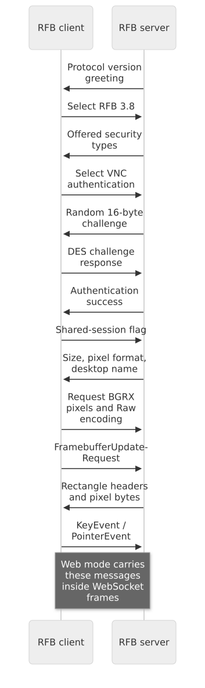

# 3. Displays, remote access and input protocols

[Guide index](README.md) · [Previous: build and boot](02-build-and-boot.md) ·
[Next: operation and tests](04-operation-and-testing.md)

A desktop needs a place to draw and a way to receive input. In nested mode the host
desktop supplies the outer display. In remote modes the container exports pixels
and accepts input through a network protocol. Those are different connections.

## Plasma, KWin, Qt and a display server

**KDE Plasma** provides the desktop experience: panels, application launchers and
session components. **KWin** manages windows. In a Wayland session it is also the
compositor and display server. In an X11 session it works with an X server.

**Qt** is a UI toolkit used by many KDE applications and by the test editor. Its
platform integration chooses how an application connects to a display:

| Setting | Application connection |
| --- | --- |
| `QT_QPA_PLATFORM=wayland` | A Wayland connection to a compositor |
| `QT_QPA_PLATFORM=xcb` | An X11 connection through Qt's XCB integration |
| `WAYLAND_DISPLAY=wayland-0` | Usually the socket name inside `XDG_RUNTIME_DIR` |
| `DISPLAY=:100` | X11 display number 100; the local socket is commonly `X100` |

Changing `QT_QPA_PLATFORM` for one application does not create a display server.
Likewise, setting `DISPLAY=:100` does not start Xvfb. The appropriate server must
already exist.

### Wayland and X11

A Wayland client exchanges protocol messages and buffers with the compositor. The
compositor combines the surfaces and routes input to the appropriate client. An X11
client connects to an X server, while a window manager such as KWin controls window
management policy. See the [Wayland architecture overview](https://wayland.freedesktop.org/architecture.html).

A Unix socket provides the local communication endpoint. A socket file is not an
image of the desktop: opening it initiates a display protocol connection.

The Wayland session also enables rootless Xwayland for applications that require
X11. That does not change the session's backend to X11. Rootless Xwayland presents
individual X11 application windows through the Wayland compositor.

## The eight combinations

| Backend | Mode | Main display path |
| --- | --- | --- |
| Wayland | `nested` | KWin's Wayland or X11 windowed backend, connected to the host |
| Wayland | `headless` | KWin's virtual backend |
| Wayland | `vnc` | Virtual backend plus KRFB's exported virtual monitor |
| Wayland | `web` | Wayland VNC path plus websockify and noVNC |
| X11 | `nested` | Rootful Xwayland or Xephyr, then KWin X11 |
| X11 | `headless` | Xvfb, then KWin X11 |
| X11 | `vnc` | Xvfb plus x11vnc |
| X11 | `web` | X11 VNC path plus websockify and noVNC |

**Headless** describes the absence of a physical or host-window display. It does
not mean that there is no graphical session. The desktop can still render into an
off-screen display and run applications.

## Nested mode and the host transport



[Mermaid source](diagrams/nested.mmd). Arrows here show desktop/display content
flowing toward the host display server. Input travels back through that connection.

### A Wayland desktop on a Wayland host

The host socket is mounted under `/run/host/wayland`. The nested compositor connects
to that socket as a client, while offering its own private display to its desktop
applications.

```text
Host display socket:       /run/host/wayland
Container client display:  /run/plasma/wayland-0, normally reserved by KDE's wrapper
```

These paths have different jobs. Mounting the host runtime over `/run/plasma` would
mix the host connection with the container's own session sockets, permissions and
bus. The project keeps them separate.

The adapter adds an explicit `--wayland-display HOST_SOCKET` backend option. It also
preserves the wrapper's `--wayland-fd`, socket name and Xwayland-related options.

### A Wayland desktop on an X11 host

The same KWin Wayland compositor can render into an X11 host window. The adapter
uses `--x11-display HOST_DISPLAY` and the host authentication cookie. Desktop apps
still connect to the container's private Wayland compositor.

The **outer** X11 connection is not the same as the optional **inner** Xwayland
connection used by legacy desktop applications.

### An X11 desktop on a Wayland host

The project runs rootful Xwayland. Here “rootful” refers to Xwayland's desktop/root
window presentation; it does not mean the server process runs as Linux UID 0. The
service runs as `plasma`.

KWin X11 and the X11 desktop use that private X server. Xwayland's outer surface is
a window on the host's Wayland compositor. This differs from the rootless Xwayland
used for individual legacy apps in a Wayland session.

The command uses `-shm` and does not request `-decorate`. A decoration path involving
libdecor/GTK can request desktop portals before the X server becomes ready, while
the portal itself waits for that X server. Avoiding that startup cycle is the reason
for the current command shape in [`plasma-xserver`](../libexec/plasma-xserver).

### An X11 desktop on an X11 host

**Xephyr** is an X server that displays its screen in a window on another X server.
It gives the container a private root window. The container's KWin X11 manages
windows inside that private display rather than managing the host's root window.

### Authentication and X11 display numbers

X11 uses an authorization cookie in an Xauthority file. A display number alone is
not an authentication credential. The host cookie file is mounted read-only, then
copied into a private file with a wildcard address family so the container hostname
does not prevent the intended cookie from matching.

The transformation changes cookie-address matching. It does not disable the host
X server's authentication or create a new unrestricted cookie.

```bash
# Teaching excerpt from the normalization pipeline; paths must already be set.
# nlist emits the existing cookie entries in numeric form.
# ffff changes the address family to wildcard in the private copy.
# nmerge imports the transformed entries into the container-owned file.
# xauth -f "$host_cookie" nlist | sed 's/^..../ffff/' | xauth -f "$private_cookie" nmerge -
```

The module also creates a different cookie for the private X11 desktop, normally
`:100`. If the host itself uses `:100`, it chooses `:101`. KDE's Wayland wrapper
manages its own Xwayland display/socket/authentication selection separately.

### Why host aliases are created after tmpfiles

Host X11 sockets are mounted at `/run/host/X11`, allowing the container's own
`/tmp/.X11-unix` to remain writable. A local symlink makes the selected host socket
available at the normal X11 path. Systemd-tmpfiles can clear X11 temporary files at
boot, so `plasma-host-display.service` creates the alias afterward.

It also writes an X display lock naming PID 1 for that host number. KDE's Xwayland
wrapper then treats that number as occupied instead of deleting the alias and
reserving its own Xwayland socket at the same number. Without this reservation,
a nested compositor can accidentally connect to its own not-yet-ready X server.

## Headless displays and software rendering

**Xvfb** supplies a virtual X11 screen whose framebuffer is kept off-screen.
**KWin's virtual backend** supplies a Wayland output without a host window or a
physical display device.

The image includes Mesa drivers and defaults to `LIBGL_ALWAYS_SOFTWARE=0`, allowing
GPU rendering. Init checks render-node access as `plasma`. When no node is usable,
it writes `LIBGL_ALWAYS_SOFTWARE=1` and `QT_QUICK_BACKEND=software` into the service
environment. This also allows Qt desktop components to start without GPU EGL.
KWin uses QPainter when its backend has no render device.
Current Arch's KWin 6.8 uses Mesa software OpenGL through `/dev/udmabuf` instead;
see [the host preparation commands](../README.md#rendering-and-vnc-responsiveness).

GPU rendering requires accessible `/dev/dri` devices and compatible drivers. The
privileged Docker examples expose those devices; rootless Podman still depends on
host-user access. An environment setting does not grant device permissions. Setting
`LIBGL_ALWAYS_SOFTWARE=1` requests software rendering from Mesa consumers; inspect
KWin's support information to establish the actual compositor and driver.

KWin's screencast API supports OpenGL compositing and rejects QPainter capture.
For Wayland VNC/web without a GPU, the conditional
[`plasma-software-display.service`](../systemd/system/plasma-software-display.service)
starts a private Xvfb display (normally `:110`). KWin nests its Wayland compositor
on that X11 parent, using QPainter. x11vnc captures the parent display and sends
input to KWin's parent window, which forwards it to the native Wayland desktop.
`x11vnc` disables modifier-state rewriting for this path. A small
[`XTest compatibility library`](../compat/xtest-paced.cpp), loaded only into this
software VNC process using `LD_PRELOAD`, gives each keyboard edge at least 5 ms of
X server time. Fast Shift/Ctrl chords otherwise lose transitions in this nested
path. The library forwards to the real `XTestFakeKeyEvent` through `RTLD_NEXT`;
it does not intercept pointer input or frame delivery.

This preserves Wayland applications without requiring GPU-only capture. Local
headless/nested sessions continue using their normal display paths.
On current Arch, software capture stays on the OpenGL/PipeWire path using CPU
rendering and the kernel DMA-buffer device; the private Xvfb path applies to the
older KWin versions in Fedora, Debian and Ubuntu.

The performance suite's `--no-gpu` option masks `/dev/dri` with an empty tmpfs.
Rootless Podman imports host devices after tmpfs mounts in privileged mode, so its
no-GPU test additionally omits privileged device imports and grants systemd's
capabilities explicitly. The renderer assertion verifies that the test actually
uses software rendering without choosing a software renderer in advance.

## Remote video: virtual output to client pixels



[Mermaid source](diagrams/remote-video.mmd). This is the pixel flow. The reverse input
flow is shown separately below. In web mode, websockify also serves the noVNC files
pictured in the diagram.

### Wayland with GPU: KRFB, KDE screencast and PipeWire

`krfb-virtualmonitor` asks KWin to create a virtual monitor named `Plasma`. KWin
exposes it as `Virtual-Plasma` on newer KWin. Debian 13 captures its existing
virtual output because KWin 6.3 cannot add another one to the virtual backend.
The KDE screencast protocol makes its frames
available through a PipeWire stream; KRFB turns those frames into VNC framebuffer
updates.

**PipeWire** carries the media stream. **WirePlumber** supplies session policy and
management for the PipeWire setup. In this project they are system-managed services
running as `plasma`, using the same private runtime and session bus.

They do not directly send VNC keyboard events into applications. Capturing pixels
and delivering input require different interfaces.

```bash
# Options used by the service helper; this is an illustration, not a request to
# launch another server in an already-running session.
# krfb-virtualmonitor --name Plasma --resolution 1920x1080 --port 5900 --password ...
```

KRFB's virtual-monitor capture path uses KDE's screencast interface directly. It
does not need a human to accept an interactive monitor-selection portal dialog at
container startup.

### Why the initial KWin output is disabled

KWin starts with its initial virtual output. KRFB creates another output for the
VNC stream. If both remain active, the exported monitor may contain only a second
wallpaper while the panel and windows remain on the other monitor.

[`plasma-remote-output`](../libexec/plasma-remote-output) queries `kscreen-doctor -j`,
waits for `Virtual-Plasma`, enables and prioritizes it, places it at `(0, 0)`, and
disables the other active outputs. Its check mode requires exactly one enabled
output with that name and position.

Debian's existing-output path and software capture keep their sole output instead.
KScreen versions can omit `enabled` on a new virtual output; the helper also uses
its assigned output priority when that property is absent, and waits through
incomplete output discovery.

This output arrangement is also useful for input: RFB coordinates refer to the
exported monitor, and the sole desktop output starts at the same origin.

```bash
# HOST command: query the container's Wayland output configuration as its desktop user.
docker exec --user plasma plasma6-vnc env \
  XDG_RUNTIME_DIR=/run/plasma WAYLAND_DISPLAY=wayland-0 QT_QPA_PLATFORM=wayland \
  DBUS_SESSION_BUS_ADDRESS=unix:path=/run/plasma/bus kscreen-doctor -j
```

This probe has to run against the private desktop; an unqualified host
`kscreen-doctor` would inspect the host's session instead.

### X11: Xvfb and x11vnc

For X11 VNC/web modes, Xvfb supplies the display and x11vnc exports it. x11vnc uses
the container's private X display and cookie, with a separate VNC password file.

The service options include `-forever` for continued availability after disconnects,
`-shared` for shared connections and `-noxdamage` for the chosen framebuffer-update
behavior. `-nolisten tcp` belongs to the private X server; VNC still deliberately
listens on its own TCP port.

X11's local display protocol and VNC's remote framebuffer protocol are distinct
even though one exports the other.

## RFB: what travels over VNC

RFB means Remote Framebuffer. The client receives a screen description and pixel
updates, and sends input events. The project tests implement an RFB 3.8 client.
The [RFB protocol description, RFC 6143](https://www.rfc-editor.org/rfc/rfc6143.html),
is an informational RFC documenting these messages.



[Mermaid source](diagrams/rfb-handshake.mmd).

The important message categories are:

| Direction | Message | Meaning here |
| --- | --- | --- |
| Server to client | Version/security negotiation | Agree on protocol and password authentication |
| Server to client | Server initialization | Screen size, pixel format and name |
| Client to server | Encoding selection | Tests choose Raw pixels for predictable image capture |
| Client to server | Framebuffer update request | Ask for screen rectangles |
| Server to client | Framebuffer update | Rectangle positions and their pixel data |
| Client to server | KeyEvent | A keysym and press/release state |
| Client to server | PointerEvent | Position and a button bitmask |

A TCP read can return fewer bytes than requested or combine data from multiple
messages. [`test/rfb.py`](../test/rfb.py) accumulates bytes until the next field is
complete. WebSocket message boundaries are also not treated as RFB field boundaries.

### Bytes, endianness and pixels

The test client uses Python's `struct` module to turn numbers into protocol bytes.
`>` selects network/big-endian order for message fields. That is separate from the
pixel byte layout negotiated for framebuffer data.

```python
# A teaching example following the test client's PointerEvent layout.
import struct

message_type = 5       # RFB PointerEvent.
buttons = 1            # Bit 0 means the left button is held.
x, y = 400, 250        # Absolute coordinates in the exported framebuffer.
packet = struct.pack(">BBHH", message_type, buttons, x, y)
# >  : big-endian fields
# B  : one unsigned byte, used for message type and button mask
# H  : a two-byte unsigned integer, used for each coordinate
# A connected test client sends packet over TCP or binary WebSocket.
```

The capture client requests 32-bit pixels with 24 color bits, little-endian pixel
storage, and red/green/blue shifts of 16/8/0. It interprets the bytes as BGRX when
constructing a Pillow RGB image. RFB headers remain big-endian despite that pixel
format choice.

### Password authentication and transport

The configured VNC authentication uses a random challenge and a DES-based response,
with VNC's password-byte bit convention. The project accepts 1–8 printable ASCII
characters rather than silently accepting a longer password that classic VNC
cannot fully use.

This authentication does not encrypt the entire desktop connection. noVNC's default
HTTP/WebSocket setup is also unencrypted. Keep the documented loopback publication
or provide an appropriate protected network transport.

The startup module writes a plaintext private password file for KRFB and the native
password-file format needed by x11vnc. Access restrictions matter; the x11vnc file
format is not a replacement for filesystem permissions. Supplying a password file
avoids storing the value in the runtime's configured environment, but KRFB's current
command-line password option can still expose it in process arguments.

## Web access: HTTP assets plus RFB over WebSocket

A web browser first downloads noVNC's HTML, JavaScript and related files from
websockify's HTTP server. The running noVNC client then opens a WebSocket connection.
websockify forwards the binary stream to `127.0.0.1:5900` inside the container.

```text
Browser address:              http://127.0.0.1:6080/vnc.html
Browser transport endpoint:   ws://127.0.0.1:6080/websockify
Container VNC backend:       127.0.0.1:5900
```

The browser and backend loopback addresses belong to different network contexts:
the first two are host-published endpoints in these examples; the last is container
loopback. The [noVNC project](https://github.com/novnc/noVNC) describes its browser
client and its use of a WebSocket proxy.

The WebSocket connection begins with an HTTP upgrade handshake, then carries
framed messages over a persistent connection. It allows the browser client to
exchange binary RFB data without opening an ordinary raw TCP socket. Websockify
bridges those messages to the VNC server's TCP stream; it does not become a new
desktop compositor. The test's WebSocket library handles framing and control
messages while the RFB code interprets the payload. See the
[WebSocket protocol, RFC 6455](https://www.rfc-editor.org/rfc/rfc6455.html).

```ini
# Actual service command, split here only by the surrounding explanation.
# --web serves the packaged client files; the last address is the VNC backend.
ExecStart=/usr/bin/websockify --web=/opt/noVNC 6080 127.0.0.1:5900
```

Only 6080 needs publishing for web mode. A native VNC viewer instead connects to a
published 5900. The project downloads noVNC during image construction and checks its
archive hash; no download is necessary when a container starts.

## Remote input and the original Wayland failure



[Mermaid source](diagrams/remote-input.mmd).

A working framebuffer does not prove this path works. The earlier failure was in
KRFB's input handler, after network delivery and authentication but before the
compositor could receive input.

### Why the portal handler could not work for this monitor

A desktop portal is a D-Bus-mediated interface for operations such as choosing a
screen to share or authorizing remote control. A portal session handle identifies
the resulting session. It is not the same object as a PipeWire stream node ID.

Stock KRFB's [XDP event handler](https://github.com/KDE/krfb/blob/v26.08.1/events/xdp/xdpevents.cpp)
uses that handle to request keyboard and pointer actions. The virtual-monitor
capture path creates its stream directly through KWin and has no such portal
session. The pointer handler therefore returns without delivering events, and the
keyboard calls do not have a valid portal session to target.

The result can be misleading: authentication works, the wallpaper and panel are
visible, and screenshots look healthy, but clicks and typing do nothing.

### The KWin event plugin

[`native/kwin-input.cpp`](../native/kwin-input.cpp) supplies a KRFB events plugin for
the container's KWin session. The Wayland VNC helper sets `PLASMA_KWIN_INPUT=1`, and
the plugin checks both that setting and Qt's Wayland platform before accepting the
role. Other event-handler paths remain available for their own sessions.

The plugin's connection procedure is:

1. Connect to the private Wayland display named by the service environment.
2. Read the Wayland registry, which advertises available protocol interfaces.
3. Require `org_kde_kwin_fake_input` version 5 or newer, binding up to version 6.
4. Send the interface's application/reason request and complete its roundtrip.
5. Integrate incoming Wayland activity with Qt's event loop using `QSocketNotifier`.
6. Forward KRFB's input callbacks to the bound KWin protocol object.

The interface's `authenticate` request is an API-level request to the compositor;
it is separate from the VNC password negotiation. The desktop metadata is what
allows this executable to see the restricted interface in this setup.

```cpp
// Simplified v6 path from the plugin. m_input is an already-bound protocol object.
// State 1 means pressed; 0 means released.
void handleKeyboard(bool down, rfbKeySym key) override
{
    org_kde_kwin_fake_input_keyboard_keysym(m_input, key, down ? 1 : 0);
    wl_display_flush(m_display); // Send queued protocol requests promptly.
}
```

The pointer handler forwards absolute position and compares the new button mask
with the prior mask. A changed bit becomes a press or release. This avoids
interpreting an entire multi-button mask as one button's state. Wheel press edges
become axis events. Each client handler tracks its own button state.

### Protocol generation and Qt plugin loading

[`fake-input.xml`](../native/fake-input.xml) describes the protocol's requests and
versions. `wayland-scanner` generates C declarations and protocol metadata from
that XML. The C++ handler calls those generated functions through libwayland.

CMake coordinates the build, Ninja executes the compilation steps, and Qt's MOC
handles Qt object/plugin metadata. `K_PLUGIN_CLASS` exposes the KDE plugin factory.
The resulting `kwin.so` is installed in KRFB's event-plugin directory and selected
through KRFB's event-plugin lookup when the environment/platform checks match.

This links against KRFB's private library API. The checked source headers and
runtime library must remain compatible. The Wayland input path also requires
KWin's fake-input v5 or newer interface; failing to find it produces a clear service error
rather than silently claiming input is available.

Debian 13 ships an older KWin with fake-input v5. That protocol takes Linux evdev
keycodes instead of keysyms. The plugin reads KWin's `wl_keyboard` keymap, uses
libxkbcommon to locate each requested keysym and subtracts the XKB offset of eight
before sending the keycode. It remembers pressed keys so releases match presses.
Modifier events still come from the VNC client. Symbols absent from the session's
keymap are reported and skipped; this path does not implement arbitrary Unicode
injection. With v6, the direct keysym path above remains in use.

### Scoped permission and connection lifetime

The image adds `org_kde_kwin_fake_input` to the virtual-monitor desktop entry's
`X-KDE-Wayland-Interfaces` list. It does not disable KWin's global permission checks.

```ini
# Installed metadata for this executable's requested Wayland interfaces.
# The first interface supplies capture; the second supplies the added input path.
X-KDE-Wayland-Interfaces=zkde_screencast_unstable_v1,org_kde_kwin_fake_input
```

The connection goes to the container's private KWin display. It does not inject
physical input devices on the host. When the handler is destroyed, it destroys its
fake-input device and disconnects. KWin's device cleanup releases held keys and
buttons belonging to that device.

### Modifiers are events too

RFB clients report modifier transitions as well as character keysyms. A capital
letter or punctuation character may require Shift, while Ctrl+S requires holding
Control during the `s` event. The test client models these transitions explicitly.

```python
# Teaching example using the real test client's methods.
# client is an authenticated RFBClient instance.
# Send Control down, s down/up, then Control up.
# client.chord(0xFFE3, ord("s"))

# The text helper also sends Shift transitions for capitals and US-keyboard symbols.
# client.text("Hello, VNC!\n")
```

A missing release can leave an input state held. Merely sending screenshots cannot
catch mistakes in this part of the protocol. The project's UI test verifies mixed
case, punctuation, digits, newlines and a Save shortcut through a real editor.

Continue with [operating and testing the project](04-operation-and-testing.md).
