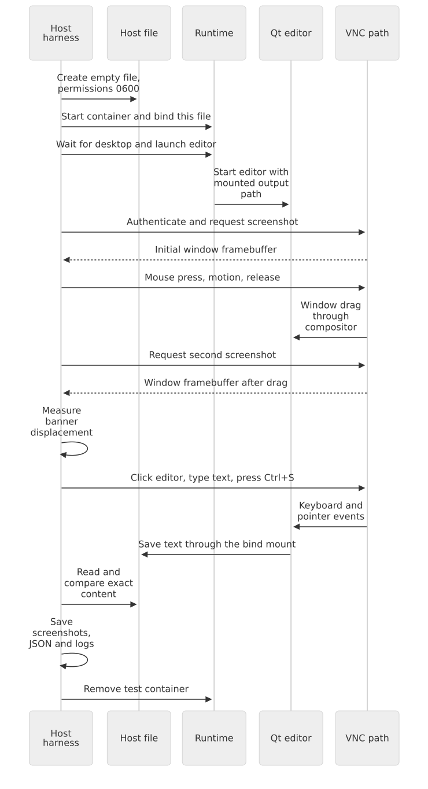

# 4. Operating, diagnosing and testing the desktop

[Guide index](README.md) · [Previous: displays and protocols](03-displays-and-protocols.md) ·
[Next: reference](05-reference.md)

This chapter connects the architecture to daily use. All commands start on the
host unless their comments say otherwise. Run them from the repository root.
The [project README](../README.md) contains the complete command matrix for both
engines; the walkthrough here explains one representative path.

## Before the first run

You need a local Linux container environment with the chosen engine configured.
The documented Podman path is rootless and uses cgroup v2. Nested mode additionally
needs a running host desktop and a socket you can mount. VNC/web/headless modes do
not require a host desktop.

```bash
# HOST: check that the selected engine is available.
docker version
# For rootless Podman instead:
podman info --format '{{.Host.Security.Rootless}}'

# HOST: inspect your identity before supplying it to a run command.
id -u
id -g

# HOST: identify the active cgroup filesystem type on Linux.
stat -fc %T /sys/fs/cgroup
```

`cgroup2fs` indicates the cgroup v2 filesystem. Host engine installation, subordinate
UID/GID allocation and rootless delegation are host-administration tasks. Use your
engine's official setup instructions for your distribution.

## An annotated first web desktop

### 1. Build the production image

```bash
# HOST: build the default final stage and name it plasma6:local.
docker build -t plasma6:local .
```

The initial build downloads packages and compiles the plugin. Later builds can
reuse unchanged layers. A cache hit means that build work was reused, not that a
running container was updated.

### 2. Create a password file

The example below asks for a password without printing it and writes the local file
with restricted permissions. The project permits 1–8 printable ASCII characters for
classic VNC authentication.

```bash
# HOST: Python reads the secret interactively; the value is not a shell argument.
python3 - <<'PY'
from getpass import getpass
from pathlib import Path

secret = getpass("VNC password (1-8 printable ASCII characters): ")
if not (1 <= len(secret) <= 8 and all(32 <= ord(char) <= 126 for char in secret)):
    raise SystemExit("Password must contain 1-8 printable ASCII characters")
path = Path("vnc-password")
path.touch(mode=0o600, exist_ok=True)
path.chmod(0o600)  # Also restrict permissions if the file already existed.
path.write_text(secret)
PY
```

The filename is ignored by the repository's `.gitignore`. Keep its value out of
commits and examples. The project still has the KRFB process-argument limitation
described in [chapter 3](03-displays-and-protocols.md#password-authentication-and-transport).

### 3. Start the desktop

```bash
# HOST: start a Wayland desktop exported through noVNC on the host's loopback port.
docker run -d --rm --name plasma6-learn-web \
  --privileged --user=0:0 --userns=host --cgroupns=private \
  --pids-limit=8192 --shm-size=512m --tmpfs /run --tmpfs /tmp:mode=1777 \
  --mount "type=bind,source=$PWD/vnc-password,target=/run/secrets/vnc-password,readonly" \
  -e VNC_PASSWORD_FILE=/run/secrets/vnc-password \
  -e PLASMA_UID="$(id -u)" -e PLASMA_GID="$(id -g)" \
  -e DISPLAY_BACKEND=wayland -e DISPLAY_MODE=web \
  -p 127.0.0.1:6080:6080 plasma6:local
```

The password source is a host file. `/run/secrets/vnc-password` is its container
path. Init reads it before the service account is used and prepares the runtime
credential files.

The published port belongs to the host. The VNC backend stays accessible to
websockify through the container's own loopback connection. Another container can
have its own internal 5900/6080 while needing a different published host port.

### 4. Check readiness and open the desktop

```bash
# HOST: this performs the project's readiness checks inside the container.
# A nonzero exit during initial startup means it is not ready yet.
docker exec plasma6-learn-web plasma-healthcheck

# HOST: inspect the selected target and published endpoint.
docker exec plasma6-learn-web readlink -f /etc/systemd/system/default.target
docker port plasma6-learn-web 6080/tcp
```

Open `http://127.0.0.1:6080/vnc.html`, connect and enter the password. A successful
health check checks the desktop and relevant transports, but it does not simulate
input. You should be able to drag a window and type; the automated UI suite below
verifies those actions.

### 5. Stop this example when finished

```bash
# HOST: request systemd's orderly shutdown; --rm then removes this container.
docker stop plasma6-learn-web
```

A stopped `--rm` container is gone, so later `exec` commands cannot inspect it. Save
logs or persistent work before removal when needed. The UI suite saves its evidence
before it removes its test containers.

### Using Podman for the walkthrough

Build with `podman build --format docker --layers -f Dockerfile.fedora-44 -t plasma6:fedora-44 .`, then use the
complete Podman web command from the [README's Fedora examples](../README.md#fedora-44)
(expand the Rootless Podman commands).
The key additions/changes are `--systemd=always --passwd=false --userns=keep-id`
while retaining `--user=0:0` and the caller's `PLASMA_UID/GID`.

The optional launcher also supplies an explicit Podman health command, so an OCI
import missing image health metadata still receives a health check. Direct commands
can add `--health-cmd=/usr/local/bin/plasma-healthcheck` for that situation.

## Adding persistent work

Use a writable host directory or suitable volume for files that must outlive the
container. The documented identities let the desktop write host data as your
mapped user. Avoid fixing an identity problem by making everything world-writable.

```bash
# HOST: prepare a host directory before creating a container.
mkdir -p "$PWD/shared"

# Add this option to the run command before the image name:
# --mount "type=bind,source=$PWD/shared,target=/home/plasma/Shared"
```

A directory mount is convenient for real applications that save by writing a
replacement file and renaming it. A single-file bind mount refers to one existing
file and can restrict that replacement strategy. The test editor intentionally
uses a direct file write, so its single-file mount is suitable for that test.

The project's temporary mounts are for runtime state, not storage for your work.
Also note that `--rm` removes a container, not arbitrary host bind-mounted files.

## Read logs at the correct layer

The init framework writes its startup decisions to standard error. The container
runtime collects that output. The desktop services normally log through systemd's
journal, so container logs and the journal answer different questions.

```bash
# HOST: see entrypoint decisions and output collected by the runtime.
docker logs plasma6-vnc

# HOST command: read the container's journal for its desktop session service.
docker exec plasma6-vnc journalctl -b -u plasma-session --no-pager

# HOST command: inspect remote exporter messages, including the input-plugin message.
docker exec plasma6-vnc journalctl -b -u plasma-vnc --no-pager
```

Replace `docker` with `podman` for the matching container. These commands read the
journal kept inside that container. A full journal in a privileged setup can also
include kernel messages. Unit filtering is useful when focusing on a particular
desktop component.

```bash
# HOST: inspect the unit's actual loaded definition and recent status.
docker exec plasma6-vnc systemctl cat plasma-vnc.service
docker exec plasma6-vnc systemctl status plasma-vnc.service --no-pager

# HOST: list failed units; interpret them alongside the affected project service.
docker exec plasma6-vnc systemctl --failed --no-pager
```

A warning from a hardware-related distribution service is not the same evidence as
a failed desktop service. Use the selected target, service state, relevant logs and
observable behavior together.

## Inspecting the private environment

An ordinary `docker exec ... env` shows the environment of that new exec command.
It is not guaranteed to show the environment of a systemd-launched desktop process.
Read the generated configuration as data:

```bash
# HOST command: view the intended service environment.
docker exec plasma6-vnc cat /etc/plasma/session.env

# HOST command: inspect the desktop account after startup identity adjustment.
docker exec plasma6-vnc id plasma
```

Do not blindly source that file as a shell script. Systemd's environment-file
parsing and shell command execution are different operations; values should remain
data.

For an explicit diagnostic application launch, supply its private connection
variables:

```bash
# HOST command: open Konsole inside a running Wayland container desktop.
# The private bus/display settings prevent accidental use of a host session.
docker exec --user plasma plasma6-vnc env \
  XDG_RUNTIME_DIR=/run/plasma WAYLAND_DISPLAY=wayland-0 QT_QPA_PLATFORM=wayland \
  DBUS_SESSION_BUS_ADDRESS=unix:path=/run/plasma/bus konsole --separate
```

The UI test similarly launches its editor as setup. It then sends every tested
mouse and keyboard action through RFB.

## Diagnose problems by layer

| Symptom | Check | Likely area and next action |
| --- | --- | --- |
| Container exits immediately with an init error | `docker logs` / `podman logs` | Correct invalid mode/IDs/password or missing mounted nested socket |
| Init complains it is not root | Runtime user options | Keep `--user=0:0`; use `User=plasma` at the service level |
| UID already belongs to another account under Podman | User namespace/passwd options | Ensure `--passwd=false`; inspect the requested runtime IDs |
| Systemd cannot manage its units | Cgroup setup, engine configuration, PID 1 | Check supported Linux/cgroup v2 setup and Podman's `--systemd=always` |
| Threads/forks fail with resource-unavailable errors | `pids.max`, `pids.current`, `pids.events` | Use the explicit process budget and inspect parent limits |
| Nested mode cannot connect to Wayland | Host socket path/type, mapped identity | Mount the actual socket separately from `/run/plasma` |
| Nested X11 cannot open the host | Host display, Xauthority, alias and lock | Check host credentials and `plasma-host-display.service` after tmpfiles |
| Wayland VNC shows wallpaper but lacks the expected panel/windows | `kscreen-doctor -j`, VNC `ExecStartPost` logs | Verify only `Virtual-Plasma` is enabled at `(0, 0)` |
| Browser cannot load noVNC | Published port and `plasma-web.service` | Check host endpoint and HTTP service |
| Browser loads but cannot connect to the desktop | `plasma-vnc`, credentials, proxy logs | Static assets loading does not prove the RFB backend is ready |
| Video works but input does not | VNC service log, plugin and interface permission | Verify the KWin input plugin is present and enabled; run the UI suite |
| A host-mounted file cannot be saved | Numeric ownership, mapping and mount mode | Check caller/desktop IDs and read-write access; test a directory mount for rename-based saves |
| Rebuilt image seems to have no effect | Container image identity | Recreate the container; restart alone keeps its original image and options |

### Focused input checks

```bash
# HOST: check the installed binary plugin.
docker exec plasma6-vnc ls -l /usr/lib64/qt6/plugins/krfb/events/kwin.so

# HOST: check which restricted Wayland interfaces the executable requests.
docker exec plasma6-vnc grep '^X-KDE-Wayland-Interfaces=' /usr/share/applications/org.kde.krfb.virtualmonitor.desktop
```

After an authenticated client connects, the VNC journal should include the plugin's
message about keyboard, buttons, scrolling and absolute pointer being enabled.
The plugin is constructed for accepted RFB clients; a banner-only VNC readiness
probe does not instantiate and exercise the entire input path.

## The basic validation suite

```bash
# HOST: validate shell scripts, init, units and supported modes (eight; four on Arch).
bash test/test.sh --capture

# HOST: use Podman's image store and runtime for the same suite.
RUNTIME=podman bash test/test.sh --capture

# HOST: a machine without a local desktop can omit the two nested cases.
bash test/test.sh --capture --skip-nested
```

[`test/test.sh`](../test/test.sh) runs ShellCheck, the disposable-container init
tests, `systemd-analyze verify`, and the host integration harness. The harness
uses the host launcher to cover its runtime-specific options as well as service
startup. It saves service state, account IDs, namespace maps, journals and optional
screenshots before cleanup.

`--capture` authenticates a client and obtains frames over TCP or the web proxy.
It checks that the image contains substantial content. That is a stronger check
than a listening port, but it still does not prove window dragging or typing.

## The interactive UI suite

The interactive suite adds observable effects of real input. It uses a native Qt
editor compiled into the test target. Wayland cases launch it with the Wayland Qt
platform, and X11 cases launch it with XCB.

```bash
# HOST: package the test editor alongside the production runtime.
docker build --target ui-test -t plasma6:ui-test .

# HOST: run four cases: Wayland/X11, each over VNC and the web proxy.
uv run test/ui.py --runtime docker --image plasma6:ui-test

# HOST: repeat against a native Podman build.
podman build --format docker --layers --target ui-test -t plasma6:ui-test .
uv run test/ui.py --runtime podman --image plasma6:ui-test
```

`uv` reads the script's inline dependency declaration and supplies its host-side
Python libraries: PyCryptodome for VNC authentication, Pillow for images and
websocket-client for the web transport. Those libraries are not added to the
production container for testing.



[Mermaid source](diagrams/ui-test.mmd).

### What the test is allowed to do

The host prepares an empty output file with mode `0600` and bind-mounts that single
file at `/e2e-output/typed.txt`. It starts the container and launches the editor with
that output pathname. It does not give the application the expected text through a
command argument, environment variable or host file write.

After setup, the tested interactions are RFB mouse and keyboard events. The Save
UI action is what writes the text into the mounted file.

### Screenshot-based window dragging

The test editor contains a distinctive colored banner. The harness finds that
banner's bounding box in the remote framebuffer, drags the titlebar with press,
absolute-motion and release events, and finds the banner again in a second frame.

```python
# Simplified geometry check from test/ui.py.
# Both coordinates are measured from actual captured framebuffers.
requested_dx, requested_dy = 150, 90
measured_dx = after_box[0] - before_box[0]
measured_dy = after_box[1] - before_box[1]

# A small tolerance allows rendering/position rounding; zero movement fails.
assert abs(measured_dx - requested_dx) <= 8
assert abs(measured_dy - requested_dy) <= 8
```

The implementation identifies pixels close to RGB `(18, 210, 178)`, allowing three
levels of channel difference. It also requires a sufficiently large bounding box
to avoid treating a tiny matching pixel as the editor banner. This validates an
actual screen displacement without relying on a mocked window-position function.

### Text input, modifiers and a host file

The test clicks the editor, types mixed case, punctuation, digits and newlines,
then sends Ctrl+S. The expected payload is 79 characters:

```text
Plasma VNC UI test
Mouse drag + keyboard: AaZz 0123456789!?
Saved from the UI.
```

There is a final newline after the last line. The client sends modifier transitions
for capitals/symbols and the save shortcut. The harness reads the host file and
compares the decoded text exactly with that payload. It also checks the host owner
UID.

The test application's relevant behavior is a normal UI-triggered file save:

```cpp
// Teaching excerpt from native/ui-fixture.cpp; output is the mounted pathname.
// This code is called by the Save button or its Ctrl+S shortcut.
QFile file(output);
if (file.open(QIODevice::WriteOnly | QIODevice::Truncate)) {
    file.write(editor->toPlainText().toUtf8()); // Text comes from the visible editor.
    file.close();                            // Host can now read the same file.
}
```

### Artifacts and what each one proves

| Artifact in each case directory | Purpose |
| --- | --- |
| `01-before-drag.png` | Initial visible editor position |
| `02-after-drag.png` | Position after actual RFB pointer/button events |
| `drag-comparison.png` | Side-by-side visual review |
| `03-after-typing-and-save.png` | Visible text and Save status |
| `host-files/typed.txt` | Actual host file written through the UI |
| `expected.txt` | Host-side expected value; not mounted into the editor |
| `result.json` | Measured boxes/deltas, text comparison, owner check and error details |
| `vnc.log`, `journal.log`, `container.log`, `processes.log` | Diagnostics captured before removing the container |

The suite prints the run directory under `test/.artifacts/`. Those files remain
available after container teardown and are ignored by Git.

```bash
# HOST: discover result files, including files under the ignored artifacts directory.
rg --files --hidden --no-ignore test/.artifacts | rg '/result.json$'

# HOST: replace YOUR_RUN with the directory printed by your test invocation.
result_file='test/.artifacts/YOUR_RUN/wayland-vnc/result.json'
python3 -m json.tool "$result_file"
```

### The negative control

A regression test should fail when the fault is present. The `ui-baseline` target
keeps stock KRFB and the same Qt editor without the KWin input plugin.

```bash
# HOST: build the intentionally unfixed test target.
docker build --target ui-baseline -t plasma6:ui-baseline .

# HOST: this is expected to fail its drag and text-save assertions on Wayland.
uv run test/ui.py --image plasma6:ui-baseline --backends wayland --modes vnc
```

A visible editor combined with measured movement `(0, 0)` and unchanged file text
reproduces the original failure. The fixed target passes those checks without
changing the expected UI outcomes.

### What the input suite establishes

The web case uses the actual WebSocket proxy and RFB backend. It does not drive a
browser DOM or test every noVNC JavaScript interaction. The editor is a controlled
native Qt application, not a promise about every possible application or keyboard
layout. These tests also do not benchmark rendering speed, validate transport TLS,
or establish GPU-driver compatibility.

They establish that the supported backend/transport combinations can move a real
window and deliver the tested text/modifiers to a real UI file save. Keep both the
basic and interactive suites when changing display, input or identity handling.

## Measuring responsiveness in the browser

The separate performance suite uses the real noVNC JavaScript client in Chromium,
not the raw RFB screenshot client. Its native Qt window paints a changing colour
marker at approximately 60 Hz. The browser counts changes in the displayed canvas,
so an empty framebuffer response or a browser-only animation cannot inflate fps.
A second marker changes only after an `A` key reaches the native app. Timing ends
when that changed pixel comes back through capture, VNC and noVNC's canvas.

```bash
# HOST: compile the test-only animation program into the UI image.
docker build --target ui-test -t plasma6:ui-test .

# HOST: verify GPU rendering and measure local 1920x1080 browser feedback.
uv run test/performance.py --image plasma6:ui-test --expect-renderer gpu

# HOST: hide GPU nodes; exercise automatic fallback rather than forcing QPainter.
uv run test/performance.py --image plasma6:ui-test --no-gpu --expect-renderer software --min-fps 20

# HOST: compare against stock KRFB while retaining functioning input.
docker build --target ui-perf-baseline -t plasma6:perf-before .
uv run test/performance.py --image plasma6:perf-before --measure-only
```

Use `--runtime podman` after building the selected image into Podman's store.
Chromium must be installed on the host; `uv` supplies the Python packages.
The suite preserves raw timing samples, renderer information, browser/service logs,
and screenshots before and after a real browser-driven window drag. Its default
checks require 25 visible fps and keyboard p95 at most 150 ms over local transport;
use `--min-fps` and `--max-latency-p95` for a different host performance budget.
Those numbers characterize this controlled UI workload, not every application or
network. The input suite still validates exact text saved into a host-mounted file.

Three implementation details affect responsiveness:

1. Upstream KRFB checks for updates every 50 ms. A frame deferred by LibVNCServer
   is revisited on a later timer tick. The local patch removes that extra deferral
   and uses a precise timer, defaulting to a 17 ms interval for a 60 fps budget.
2. PipeWire damage metadata lists screen rectangles that changed. Requesting it
   lets KRFB encode those regions instead of marking the whole desktop dirty.
   The complete image remains available; capture's existing full-frame fallback
   still applies when a producer provides no damage information.
3. Rendering and encoding are separate costs. GPU/OpenGL preference accelerates
   compatible rendering; the VNC server still has to encode changed pixels.
   Higher resolution and compression can increase that cost.

The source patch lives in [`krfb-low-latency.patch`](../patches/krfb-low-latency.patch).
`VNC_MAX_FPS=1..60` selects the remote update budget; idle frames are not
continuously transmitted. For a slower link, reduce resolution or the fps budget
and adjust noVNC's Quality/Compression controls. These changes do not require a
different input protocol.

## Testing application sessions

`TARGET_APP` changes which graphical session starts, so it has a separate test
matrix in [`test/kiosk.py`](../test/kiosk.py). The test editor and real Chromium
run as the configured startup applications, rather than being added to an already
running Plasma desktop.

```bash
# HOST: test images include the editor; production includes Chromium only.
docker build --target ui-test -t plasma6:ui-test .
uv run test/kiosk.py --image plasma6:ui-test

# HOST: test the same application startup through software-only remote capture.
uv run test/kiosk.py --image plasma6:ui-test --no-gpu --backends wayland --modes vnc web

# HOST: build into the rootless engine's store, then run its full matrix.
podman build --format docker --layers --target ui-test -t plasma6:ui-test .
uv run test/kiosk.py --runtime podman --image plasma6:ui-test
```

The normal matrix contains both apps on all supported display profiles (eight on
Fedora/Debian/Ubuntu, four Wayland profiles on Arch). Use
`--modes headless vnc web` on a host without a display socket. Local-mode cases
check the selected application, one KWin instance and absence of the full Plasma
session. Remote cases also inspect fullscreen screenshots and send real RFB input.
The editor saves the exact text into the host-mounted file; the Chromium fixture
changes a visible status colour only when its input contains the expected text.

Each remote case then kills only its own application process and checks that a
new app PID appears under the same supervisor, KWin keeps its PID, and the same
VNC connection sees the replacement fullscreen window. Logs, process lists,
assertions, host files and screenshots survive under `test/.artifacts/kiosk-*`.
Keep the ordinary desktop boot suite as a regression check that an unset
`TARGET_APP` still starts Plasma.

## Safely following a change through the project

| Changed component | Useful verification |
| --- | --- |
| Init validation or account mapping | Disposable init tests and identity-fixture nested cases |
| Service dependencies | Unit verification, selected-target boot and journals |
| KWin arguments or host socket preparation | Nested cases on the relevant host transports |
| VNC pixels or output layout | Authenticated captures and output checks |
| Remote keyboard/pointer plugin | Interactive UI suite, including host-file and screenshot evidence |
| Capture, encoding cadence or renderer defaults | Browser performance suite with GPU and automatic software fallback |
| Documentation only | Link checks, code-example syntax and diagram rendering |

The account fixture in [`test/Dockerfile.uid-fixture`](../test/Dockerfile.uid-fixture)
starts with UID/GID 2000. Running nested integration against it on a host with
other caller IDs tests the runtime mapping path rather than merely relying on both
sides accidentally being UID 1000.

Continue with the [file map, tools and glossary](05-reference.md).
