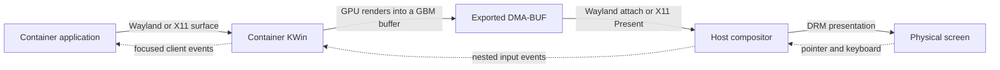
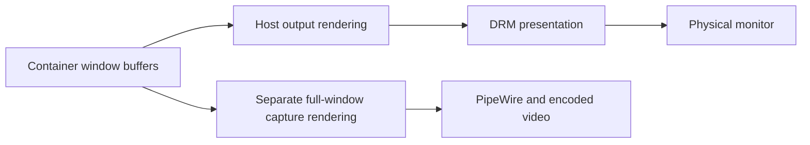

# Debugging EGL, GBM, and nested display output

A working OpenGL context proves that a GPU can render. It does not prove that
another compositor receives the right buffer at the right time. Check each
boundary separately before changing renderer settings.



**EGL** creates rendering contexts and imports images. **GBM** allocates graphics
buffers. A **DMA-BUF** is a file descriptor referring to a buffer that another
process can import. Its **fourcc format** describes the pixel layout; its
**modifier** describes tiling or compression. A **fence** tells the consumer when
GPU work on that buffer has finished. Correct pixels and compatible modifiers
are necessary, but synchronization and buffer lifetime also matter.

## 1. Identify the actual compositor renderer

These commands work with the production images. Replace `docker` with `podman`
when inspecting a Podman container.

```bash
# Choose an existing container. These commands do not restart it.
ctr=plasma6-nested-wayalnd

# Startup probes: every visible render node, including unsuccessful probes.
docker exec "$ctr" cat /etc/plasma/gpu.json

# Actual KWin renderer: this is more specific than the list of usable GPUs.
docker exec --user=plasma "$ctr" env \
  XDG_RUNTIME_DIR=/run/plasma \
  DBUS_SESSION_BUS_ADDRESS=unix:path=/run/plasma/bus \
  qdbus-qt6 org.kde.KWin /KWin supportInformation
```

Look for `Compositing Type`, `OpenGL renderer string`, output geometry, scale,
and refresh rate. A nested compositor must select a GPU compatible with its
parent display. A successful probe on another GPU does not mean that KWin uses
that GPU for presentation.

## 2. Compare EGL platforms

Run the host commands in a terminal belonging to the graphical host session:

```bash
# Each command creates a real context using a different EGL platform.
eglinfo -B -p wayland
eglinfo -B -p x11
eglinfo -B -p gbm

# Show synchronization and DMA-BUF extensions; -B omits these details.
eglinfo -s -p wayland -a gles > host-egl-wayland.log

# The X11/GLX path is distinct from EGL.
glxinfo -B
```

Default GBM device selection can differ from the device used by the host
Wayland session. On the investigated NVIDIA + AMD machine, host Wayland and
X11 EGL selected NVIDIA, while the default host GBM test selected AMD. Use
`gpu.json` to inspect explicit render-node probes.

`eglinfo`, `wayland-info`, `wev`, and `xev` are optional diagnostic tools. Use a
disposable debug image with its distribution's matching utility packages when
they are absent. Production images do not need these tools. The investigation
also used temporary standalone binaries after checking their library
compatibility; `/tmp` and `/run` in these containers are mounted `noexec`.

With `eglinfo` available in the container:

```bash
# Connect to the container's private Wayland compositor, as the desktop user.
docker exec --user=plasma "$ctr" env \
  XDG_RUNTIME_DIR=/run/plasma WAYLAND_DISPLAY=wayland-0 \
  eglinfo -B -p wayland

# GBM bypasses the parent display socket.
docker exec --user=plasma "$ctr" eglinfo -B -p gbm
```

A successful EGL context test does not allocate, export, and verify the pixels
of every possible GBM buffer. For that stronger check, allocate a buffer with
the compositor's actual format and modifier, export its descriptor, import it
as an EGL image, render a known color, wait for its render fence, and read it
back through an independent context. Keep buffer and descriptor ownership
valid until both contexts finish.

## 3. Inspect Wayland buffer negotiation and synchronization

```bash
# Host compositor globals, outputs, and DMA-BUF feedback.
wayland-info > host-wayland-info.log

# Container compositor globals and feedback.
docker exec --user=plasma "$ctr" env \
  XDG_RUNTIME_DIR=/run/plasma WAYLAND_DISPLAY=wayland-0 \
  wayland-info > container-wayland-info.log

# Trace one new test client. No existing compositor needs restarting.
docker exec --user=plasma "$ctr" env \
  XDG_RUNTIME_DIR=/run/plasma WAYLAND_DISPLAY=wayland-0 \
  WAYLAND_DEBUG=client \
  timeout 8 eglgears_wayland -info > eglgears-wayland.log 2>&1
```

An exit status of 124 is expected when `timeout` ends the animation. A completely
occluded Wayland window may receive no frame callbacks; expose its parent
window before comparing animation rates.

Check the following relationships:

- `zwp_linux_dmabuf_v1` feedback identifies the main device and accepted
  format/modifier pairs. Compare the actual producer format with the consumer's
  list, rather than requiring both complete lists to be identical.
- `wp_linux_drm_syncobj_manager_v1` being advertised proves availability.
  A client must bind it and submit `set_acquire_point` and `set_release_point`
  requests to use that protocol.
- `wl_buffer.release` governs buffer reuse. It is distinct from the producer's
  render-completion fence and from `wl_surface.frame` scheduling callbacks.
- Attribute messages to their process and connection. Application-to-container
  synchronization does not establish container-to-host synchronization.

The inspected [KWin 6.7.5 nested Wayland backend](https://github.com/KDE/kwin/blob/v6.7.5/src/backends/wayland/wayland_egl_backend.cpp)
exports a render fence for its local swapchain, while its
[layer commit path](https://github.com/KDE/kwin/blob/v6.7.5/src/backends/wayland/wayland_layer.cpp)
attaches the buffer to the host without DRM syncobj acquire/release points.
That is a synchronization boundary to investigate; by itself it does not prove
that it caused a particular visible glitch. NVIDIA's
[Wayland platform documentation](https://github.com/NVIDIA/egl-wayland2)
also explains its explicit-sync requirements and the distinction between
application commits and EGL-managed commits.

## 4. Check the private Xwayland server

The host display, KWin's private Xwayland display, and the project's Xvfb display
can have different display numbers and authentication files. For a nested
Wayland session, inspect the running Xwayland arguments:

```bash
# Prints only the Xwayland command, including its display and -auth pathname.
docker exec -i "$ctr" python3 - <<'PY'
from pathlib import Path
for process in Path('/proc').glob('[0-9]*'):
    try:
        if (process / 'comm').read_text().strip() == 'Xwayland':
            print((process / 'cmdline').read_bytes().replace(b'\0', b' ').decode())
    except OSError:
        continue
PY

# Replace these values with the display and -auth path printed above.
docker exec --user=plasma "$ctr" env \
  DISPLAY=:0 XAUTHORITY=/run/plasma/xauth_EXAMPLE glxinfo -B
docker exec --user=plasma "$ctr" env \
  DISPLAY=:0 XAUTHORITY=/run/plasma/xauth_EXAMPLE xdpyinfo
docker exec --user=plasma "$ctr" env \
  DISPLAY=:0 XAUTHORITY=/run/plasma/xauth_EXAMPLE xrandr --current
```

`xdpyinfo` reports extensions such as DRI3, Present, XInputExtension, and XTEST.
Their presence establishes server support, rather than successful end-to-end
input or presentation. XTest injected directly into Xwayland also does not
establish that native Wayland clients receive those events.

## 5. Separate event delivery from visual feedback

Run an event viewer inside a disposable desktop and focus its test window:

```bash
# Native Wayland keyboard and button events.
wev -f wl_keyboard -f wl_pointer:button

# X11 events; use the private DISPLAY and XAUTHORITY discovered above.
xev -event keyboard -event button
```

Send a known string, count both press and release events, and independently
check text saved through a GUI action to a mounted host file. This distinguishes
missing input from input whose visual feedback was not presented. An input
check made through VNC validates the private VNC-to-KWin path; it does not
validate the host-window-to-KWin path.

For DRM enumeration on the NVIDIA host, the following command lists connectors,
planes, and formats without requesting a modeset:

```bash
modetest -M nvidia-drm -c -p > host-drm.log
```

## 6. Interpret captures and experiments carefully

Compare a capture inside KWin with a host-compositor capture of the same test
window. A named XComposite pixmap is before final host composition. A host
window screenshot can render the window separately from the physical output.
Neither proves that physical scanout was correct, and readback can change the
timing of a synchronization race.

### Why a Spectacle window recording can look clean

A selected-window recording has its own rendering path. In
[KWin 6.8.1's window screencast implementation](https://github.com/KDE/kwin/blob/v6.8.1/src/plugins/screencast/windowscreencastsource.cpp#L112),
`WindowScreenCastSource::render` renders the selected window into the capture
framebuffer with an infinite repaint region. This creates an image for the
recording separately from the normal output presentation path. Both paths can
use the GPU.



Consequently, artifacts can remain visible on the monitor while the selected
window's video is clean. This includes problems specific to output damage
tracking, effects, synchronization, buffer reuse, or scanout. The observation
helps separate the paths; it does not identify which of these is faulty.
Recording an entire screen provides another comparison, but still does not
film physical scanout. A camera aimed at the monitor captures that last stage.

The useful distinction is whether recording stops the visible problem, or
whether the monitor continues to show it while the video stays clean. In the
latter case, successful selected-window recordings and selected-window
screenshot tests cannot establish that the normal presentation path is correct.

Use a marker that tolerates normal opacity changes when checking whether a
window disappeared. In the investigation, a threshold-based detector flagged a
frame whose green marker was still visible but dimmed. Inspection of the saved
screenshot prevented that frame from being reported as a disappearance.

## 7. Nested NVIDIA buffer-completion compatibility

A later controlled comparison reproduced the artifacts with the fence wait off,
removed them with it on, and reproduced them again after disabling it. The same
compositor process, GPU and scheduling priority were used throughout. A separate
90-second host-window repaint experiment had not fixed the symptom.

The runtime therefore enables the
[NVIDIA fence compatibility library](../compat/egl-fence-wait.cpp) for hardware
nested Wayland sessions when startup probes find usable NVIDIA hardware. It
waits for the real native GPU render fence before KWin exports it at the raw
buffer handoff. It does not copy pixels through a software renderer, select a
new GPU, or force OpenGL ES. Only NVIDIA EGL displays wait; Mesa displays keep
the original fence-export behavior.

The compatibility hook uses libepoxy's native-fence entry point. A file
capability on KWin would make the dynamic loader ignore the preload, so init
removes that capability in these NVIDIA nested container instances. KWin can
use its normal unprivileged scheduling fallback. This does not affect GPU device
permissions or the configured account password and sudo policy.

The backend adapter sets the preload immediately before executing KWin. The
library restores the caller's original preload environment in its constructor,
so Xwayland, kiosk applications and other session applications do not inherit
the synchronization helper. Native build checks verify readiness before return,
that the original descriptor remains owned by KWin, and that Mesa does not wait.

```bash
# Check the derived activation flag in a newly created container.
docker exec "$ctr" cat /etc/plasma/session.env

# A successful NVIDIA fence wait emits this diagnostic once per compositor.
docker exec "$ctr" journalctl -b -u plasma-session --no-pager \
  --grep='Plasma NVIDIA sync'

# Verify hardware rendering separately; the expected renderer remains NVIDIA.
docker exec --user=plasma "$ctr" env \
  XDG_RUNTIME_DIR=/run/plasma \
  DBUS_SESSION_BUS_ADDRESS=unix:path=/run/plasma/bus \
  qdbus-qt6 org.kde.KWin /KWin supportInformation
```

The wait serializes the producer at the handoff, so very heavy GPU workloads can
increase frame latency. Capture success still does not establish physical
presentation correctness; use the visible monitor as part of acceptance testing.
This compatibility path can be removed when the nested backend carries the
producer's completion fence to the host itself.

## 8. Separate Debian NVIDIA virtual-output limitation

Validation with NVIDIA driver 615.78.08 found that Debian 13's packaged KWin
6.3.6 fails in Wayland VNC/web mode with `GL_INVALID_OPERATION` (image and
target incompatible), `GL_FRAMEBUFFER_INCOMPLETE_ATTACHMENT`, and a compositor
crash. Repeating the VNC case with the pre-fix image reproduced the same failure;
changing to OpenGL ES did not resolve it. The nested synchronization helper is
disabled in these modes (`PLASMA_NVIDIA_SYNC=0`), so this is a separate failure.

Debian NVIDIA nested sessions passed through both Wayland and X11 host sockets
on Docker and rootless Podman. Its remote path passed with AMD/Mesa. Fedora,
Ubuntu and Arch passed the NVIDIA remote capture checks. Use one of those
images when NVIDIA-backed remote capture is required. A working context or a
healthy headless service alone does not establish successful framebuffer capture.
