# Clipboard sharing in nested desktops

[Technical guide](README.md)

New images automatically share the clipboard between a nested desktop and its
parent display. Copy in a host application and paste in a container application,
or copy in the container and paste on the host. This also works with `TARGET_APP`
kiosk sessions. `CLIPBOARD_SYNC=0` disables sharing.

The bridge carries Unicode text, HTML, images such as PNG, file URI lists, and
other MIME data. It also forwards the primary selection used for middle-click
paste when both displays support it. Primary selection and the normal clipboard
remain separate.

## Why a display socket does not provide clipboard sharing

A Wayland socket connects a client to one compositor. Mounting the host socket
lets nested KWin display its output as a host window and receive input. That
does not connect the host's clipboard to the separate clipboard owned by the
container's KWin. A nested X11 server also has its own selections.



[Editable diagram source](diagrams/clipboard.mmd).

Wayland's ordinary data-device protocol associates clipboard access with input
focus. A background bridge uses the compositor's data-control protocol instead.
It can observe and set selections without creating a window or taking focus.
The helper supports both
[ext-data-control-v1](https://github.com/wayland-mirror/wayland-protocols/blob/main/staging/ext-data-control/ext-data-control-v1.xml)
and the older
[wlr-data-control](https://github.com/swaywm/wlr-protocols/blob/master/unstable/wlr-data-control-unstable-v1.xml).
Their checked-in protocol definitions retain their upstream copyright and license.
Supporting both matters when an older Debian container connects to a newer host.

| Endpoint | Clipboard implementation |
| --- | --- |
| Wayland | Prefer ext-data-control; otherwise use wlr-data-control |
| X11 | Qt's clipboard implementation, including X11 selection change notifications and large selection transfers |
| Wayland host without usable data-control | Use the supplied host X11/Xwayland connection when available |

KDE's `KSystemClipboard` API was considered. Older versions shipped with Debian
do not understand a newer host's ext-data-control protocol. The helper uses the
standard protocol definitions directly so all images support both generations.
X11 handling stays with Qt.

## Service startup and clipboard ownership

Only the two nested systemd targets request
[`plasma-clipboard.service`](../systemd/system/plasma-clipboard.service). It runs
as `plasma` after the desktop display is ready. Headless, VNC, and web profiles
do not start it. The existing display socket and Xauthority mounts are sufficient;
the bridge needs no host D-Bus mount or host-side daemon.

The service starts one controller and two endpoints. Each endpoint owns a
connection to its display; the controller passes MIME payloads between them over
private process pipes. The host selection wins on startup, so a newly created
desktop does not replace it with an empty initial clipboard. Each forwarded
offer includes a bridge identifier. The controller deduplicates equal MIME
payloads, so clipboard-manager history restores propagate normally while repeated
copies of the current selection do not create a feedback loop.

The helper serves the copied bytes while it owns a selection. It handles partial
pipe reads and writes, including selections larger than the pipe buffer. Transfers
are bounded to 64 MiB in total across the transferred MIME representations. A
stalled Wayland pipe transfer is abandoned after five seconds; X11 uses Qt's
selection-transfer timeouts. Partial selections are not published to the other
display. Clipboard contents are not logged or
saved to a history file by the bridge.

If the desktop restarts, systemd restarts the clipboard service with it. A lost
display connection also causes the service to restart. Its startup and failures
are visible in the journal and its state is included in nested-mode health checks.

## Screenshots and Qt image formats

Spectacle publishes an image through Qt's clipboard API. Qt can then advertise
many encodings of that one image: PNG, BMP, PPM, TIFF, HEIF and others, depending
on the installed image plugins. These representations are generated on request.
Fetching every advertised encoding can spend seconds inside codecs and expand a
small screenshot into hundreds of megabytes. See the upstream
[Qt image MIME implementation](https://github.com/qt/qtbase/blob/dev/src/gui/kernel/qinternalmimedata.cpp)
and [Spectacle's clipboard export](https://github.com/KDE/spectacle/blob/master/src/ExportManager.cpp).

When PNG is offered, the bridge requests that lossless representation once and
omits the redundant raster encodings and Qt's internal `application/x-qt-image`
alias. PNG preserves image pixels and transparency and can be pasted into Qt
applications and Chromium. Explicit SVG data and accompanying text, HTML, URI
and filename metadata remain available. When PNG is absent, the other offered
formats are forwarded normally. The 64 MiB limit applies after this format
selection; it is not multiplied by all the codecs installed on the source.

## Configuration and pure CLI use

All existing [nested Docker and Podman examples](../README.md) enable clipboard
sharing automatically after rebuilding or selecting an updated image. No extra
launcher script or command is required. The feature uses the runtime `plasma`
identity, including Docker `--userns=host` and Podman `--userns=keep-id` setups.

Add this environment option to an existing `docker run` or `podman run` command
to disable sharing:

```bash
-e CLIPBOARD_SYNC=0
```

For the optional host launcher, the equivalent is:

```bash
CLIPBOARD_SYNC=0 DISPLAY_MODE=nested ./bin/plasma6-run -d
```

If a Wayland host does not expose data-control, supply its X11/Xwayland socket
and authentication as well as the Wayland socket. These options can be added to
the existing nested run command:

```bash
# The window still uses the host Wayland connection. Clipboard sharing can
# fall back to the host's X11 selections through these additional mounts.
--mount type=bind,source=/tmp/.X11-unix,target=/run/host/X11,readonly \
--mount "type=bind,source=${XAUTHORITY:-$HOME/.Xauthority},target=/run/host/Xauthority,readonly" \
-e HOST_DISPLAY="$DISPLAY" -e HOST_XAUTHORITY=/run/host/Xauthority
```

Host compositor policy can restrict data-control access. If neither data-control
nor an authenticated X11 connection is available, the service reports the missing
capability. Use `CLIPBOARD_SYNC=0` for a desktop without clipboard sharing.

## File manager copy and paste

A file URI is a path reference, not the file's contents. For example,
`file:///shared/report.txt` is useful on both sides only when `/shared/report.txt`
exists and is accessible on both sides. Bind a shared directory at the same path
in the host and container if file-manager copy/paste should refer to those files.

The bridge excludes `application/vnd.portal.filetransfer`. That format contains
a transfer key resolved through the source session's
[file-transfer portal](https://github.com/flatpak/xdg-desktop-portal/blob/main/data/org.freedesktop.portal.FileTransfer.xml),
which is not available on the container's separate session bus. Ordinary URI
formats remain available for shared paths. Session-local KDE source IDs and
clipboard-restoration policy markers are excluded as well. The bridge does not upload files or
rewrite paths between filesystem namespaces.

## Diagnose a running container

```bash
# Replace the name with your own container. Use podman instead of docker for
# a Podman session; all these commands inspect the running desktop.
ctr=plasma6-nested

# Verify that startup enabled the bridge for this mode.
docker exec "$ctr" cat /etc/plasma/session.env

# Check service state and protocol negotiation or connection errors.
docker exec "$ctr" systemctl status plasma-clipboard.service --no-pager
docker exec "$ctr" journalctl -b -u plasma-clipboard.service --no-pager
```

Test normal copy/paste with Ctrl+C/Ctrl+V. Konsole normally uses
Ctrl+Shift+C/Ctrl+Shift+V; Ctrl+C in a terminal sends an interrupt to its foreground
process. Test images in an image-capable application such as Chromium rather than
a terminal. Test primary selection separately by selecting text and middle-clicking.

## Automated validation

[`test/clipboard.py`](../test/clipboard.py) creates an isolated parent desktop
and a nested container. It does not replace the real user's clipboard. Each case
checks bidirectional Unicode text, HTML, PNG, file URI, empty MIME data and 1 MiB
binary data, primary selections, service restart, clipboard-history replay and
absence of feedback loops. A real Qt image owner also offers a 3840 × 2160 image through
Qt's lazy image encoders, reproducing the same multi-format behavior as Spectacle.
Both directions are checked for exact RGBA pixels, including transparency.

The UI checks paste host text into a native editor, save it through the UI to a
host-mounted file, and copy new editor text back to the parent clipboard. They
also paste the 4K image into a Qt application and Chromium using real keyboard
events. The pasted images are saved to the host mount and their pixels compared
with the source. The local [Chromium test page](../test/clipboard-browser.py) saves
only images received through a browser paste event. Chromium remains exclusive
to the `ui-test` images. Before and after screenshots, saved text and images, and
service journals remain in the printed artifact directory after container cleanup.
X11-on-Wayland UI checks use the private X11 capture; the other cases capture the
nested window in its parent display. The test keeps the parent's VNC connection
open so KRFB retains its virtual monitor even during private X11 capture.

Applications started with `docker exec` or `podman exec` receive the complete
`/etc/plasma/session.env` in these tests. An exec command normally gets the image's
environment, which does not include settings generated for systemd services.
Passing the session environment makes the test app use the same display, user
configuration and rendering fallback as a normally launched desktop app.

```bash
# Use a UI-test target because the production image excludes the test editor.
docker build -f Dockerfile.fedora-44 --target ui-test -t plasma6:clipboard-test .
uv run test/clipboard.py --runtime docker --image plasma6:clipboard-test

# Load the same build into rootless Podman and test its user namespace.
docker save plasma6:clipboard-test | podman load
uv run test/clipboard.py --runtime podman --image plasma6:clipboard-test

# Exercise the single-application session with the same clipboard checks.
uv run test/clipboard.py --image plasma6:clipboard-test --kiosk
```

Arch supports a Wayland desktop. Its isolated parent can also provide an
Xwayland socket for testing Wayland-on-X11 nesting. `--host-image` selects a
different parent image when testing interoperability across distribution versions.

The Arch CI software-rendering check uses a Wayland parent. Testing its X11
transport requires a parent X11/Xwayland server with usable OpenGL support.
