# How the Plasma container works

A beginner's technical guide to the Linux, container, desktop and networking pieces
used by this project.

You can follow this guide without knowing systemd, Wayland or VNC beforehand. Some
later sections explain the C++ input plugin; the earlier chapters introduce the
terms it uses. For ready-to-run commands for every mode, keep the
[project README](../README.md) alongside this guide.

## Read in this order

| Chapter | What you will understand afterward |
| --- | --- |
| [1. Linux and container foundations](01-linux-and-containers.md) | Processes, PID 1, namespaces, cgroups, mounts, permissions and Docker/Podman options |
| [2. Building the image and booting the desktop](02-build-and-boot.md) | Build stages, init modules, systemd targets, service ordering, readiness and shutdown |
| [3. Displays, VNC, web access and input](03-displays-and-protocols.md) | All eight modes, sockets, X11/Wayland, PipeWire, RFB, noVNC and the KWin input fix |
| [4. Operating, diagnosing and testing](04-operation-and-testing.md) | An annotated first run, logs, troubleshooting and the screenshot/file-based UI tests |
| [5. Reference and glossary](05-reference.md) | File map, environment variables, paths, ports, tools and terms |
| [6. EGL, GBM and nested graphics debugging](06-graphics-debugging.md) | GPU contexts, DMA-BUF formats, fences, input events and capture limitations |
| [Diagram sources and rendering](diagrams/README.md) | Editable Mermaid sources and reproducible SVG generation |

If you are investigating a particular problem, start with
[the troubleshooting table](04-operation-and-testing.md#diagnose-problems-by-layer)
and then follow its chapter links.

## The whole project in one picture



[Editable Mermaid source](diagrams/architecture.mmd).

The desktop applications and their supporting services are ordinary Linux
processes. They run inside container-specific views of processes, files and the
network, while using the host's Linux kernel. The image supplies distribution userspace,
Plasma and the configuration that connects those processes.

Systemd supervises the desktop and its companion services. KWin manages windows
and, in Wayland sessions, also acts as the display compositor. The selected mode
chooses whether the result appears in a host window, stays off-screen, travels to
a VNC viewer, or appears through a browser.

## Three choices that are easy to confuse

| Choice | Example | What it controls |
| --- | --- | --- |
| Container engine | `docker` or `podman` | How the container is built and started |
| Desktop backend | `DISPLAY_BACKEND=wayland` or `x11` | Which kind of desktop session runs inside the container |
| Display mode | `DISPLAY_MODE=nested`, `headless`, `vnc`, `web` | Where the desktop is displayed or exported |

Nested mode has a fourth consideration: the **host transport**. A container's
Wayland desktop can appear in a window on an X11 host, and a container's X11
desktop can appear on a Wayland host. The host transport and container desktop
backend are separate connections.

For example:

```bash
# HOST: request a Wayland desktop without a physical monitor.
# This is a build/run setting, not a command to install Wayland on the host.
# Add these options to a full run command from the project README:
# -e DISPLAY_BACKEND=wayland -e DISPLAY_MODE=headless

# HOST: build the project into Docker's image store.
docker build -f Dockerfile.fedora-44 -t plasma6:local .

# HOST: inspect the resulting image's entrypoint and default command.
docker image inspect plasma6:local --format '{{json .Config.Entrypoint}} {{json .Config.Cmd}}'
```

The final command should identify `/init.d/init.sh` as the entrypoint and
`/usr/sbin/init --system` as its default command. Their relationship is explained
in [chapter 2](02-build-and-boot.md#entrypoint-cmd-and-exec).

## Where commands and files live

Examples marked `HOST` run in your normal terminal, from the repository root unless
stated otherwise. `docker exec NAME ...` and `podman exec NAME ...` start a command
inside an existing container. Paths such as `/etc/plasma/session.env` refer to the
container filesystem; `test/.artifacts/` refers to your checkout on the host.

```bash
# HOST: show the caller's numeric identity.
id

# HOST command; the inner id runs INSIDE the container.
# First start a container named plasma6-vnc using the project README.
docker exec plasma6-vnc id plasma
```

Matching the username `plasma` to the host username is unnecessary. Matching the
relevant **numeric IDs through the selected user namespace mapping** is what makes
host socket access and host file writes work.

## What is in the production image?

The image contains the desktop, runtime libraries, init modules, unit files,
noVNC assets and the compiled KWin input plugin. It inherits its systemd init
framework from `ghcr.io/skynet-core/systemd:<distro>` (Fedora 44 by default).
Debian 13 and Ubuntu 26.04 also support all eight profiles; current rolling Arch
supports the four Wayland profiles. See [distribution variants and publication](02-build-and-boot.md#distribution-variants-and-publication).

The production stage excludes the compiler/build stage and the test-only Qt editor.
The test targets deliberately include the editor so automated tests can manipulate
a real window and save a real file. This separation appears in the
[build-stage schematic](02-build-and-boot.md#the-build-stage-graph).

There is no physical-monitor requirement for headless, VNC or web modes. The default
configuration prefers GPU rendering when the desktop user can open a render node.
Otherwise it selects software rendering automatically.

## How the documentation is tied to the code

The source files linked throughout the guide define the actual behavior. Short
snippets are sometimes simplified for teaching and are labeled accordingly; they
are not replacement configuration files. The guide distinguishes:

- **Image build time:** install packages, compile the plugin and package assets.
- **Container startup:** select identities, sockets, environment and the default target.
- **Desktop runtime:** render windows and handle remote input.
- **Host-side tests:** send input, capture screenshots and inspect a bind-mounted file.

The diagrams show the project-specific paths. A target also pulls in
`multi-user.target`, so normal distribution services may run in addition to the
project services illustrated.

## A small starting vocabulary

| Term | Plain-language meaning |
| --- | --- |
| Process | A running program |
| PID | A process number in a particular PID namespace |
| PID 1 | The container's initial process, responsible here for supervising services |
| Image | The packaged filesystem and defaults used to create containers |
| Container | A running or stopped instance created from an image |
| Socket | A communication endpoint, either local or networked |
| Compositor | The component that combines application surfaces into the displayed desktop |
| Target | A systemd grouping of services and other units |
| Bind mount | A host file/directory exposed at a path inside the container |
| UID / GID | Numeric user and group identifiers |
| RFB | The remote framebuffer protocol used by VNC |
| WebSocket | A persistent browser connection that can carry RFB messages |

The [full reference](05-reference.md#glossary) adds the terms used in later chapters.

Continue with [chapter 1: Linux and container foundations](01-linux-and-containers.md).
